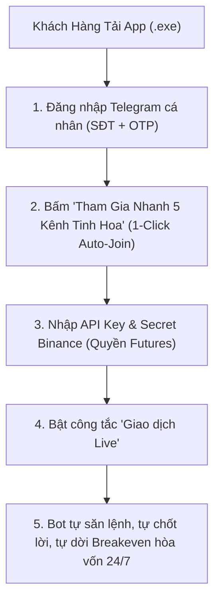

# HƯỚNG DẪN THƯƠNG MẠI HÓA & PHÁT HÀNH TRỰC TIẾP (COMMERCIAL RELEASE v1.3.1)

Tài liệu này hướng dẫn mô hình thương mại hóa trực tiếp không cần server quản lý bản quyền: **Phân phối bộ cài độc lập — Người dùng tự kết nối Telegram & Binance — 1-Click Tham Gia 5 Nhóm Tinh Hoa — Tự Động Giao Dịch 24/7**.

---

## 1. MÔ HÌNH THƯƠNG MẠI TRỰC TIẾP (ZERO SERVER REQUIREMENT)

Khách hàng chỉ cần tải file cài đặt `.exe`, không cần liên hệ xin cấp key bản quyền hay kích hoạt phức tạp:

---

## 2. TRẢI NGHIỆM NGƯỜI DÙNG: CỰC KỲ ĐƠN GIẢN

### Bước 1: Đăng nhập Telegram & Tự Động Join 5 Kênh Tinh Hoa
- Người dùng mở tab **Kết nối (Connections)** -> Nhập Số điện thoại Telegram -> Nhập mã OTP.
- Ngay sau khi kết nối, tại giao diện xuất hiện thẻ tính năng:
  `⚡ Tham Gia Nhanh 5 Kênh Tinh Hoa (1-Click Auto-Join)`.
- Người dùng chỉ cần bấm nút **"Tham Gia 5 Kênh Ngay"**:
  - Bot dùng tài khoản Telegram của họ tự động tham gia cả 5 kênh:
    1. **THE WOLF (CRYPTO)®** (`-1002007658025`)
    2. **Boom_Boom_Billionaires** (`-1001756316676`)
    3. **CRYPTO LEOPARD'S** (`-1002052872813`)
    4. **CRYPTO MONK** (`-1001552004524`)
    5. **Crypto Neon** (`-1001370457350`)
  - Đồng thời tự động kích hoạt whitelist giám sát tín hiệu cho 5 kênh này. Người dùng không phải tìm link hay bấm vào từng kênh.

### Bước 2: Nhập API Binance & Bật Live Trading
- Người dùng nhập `API Key` & `Secret Key` tài khoản Binance của họ (Chỉ cần cấp quyền Futures Trading, không cho rút tiền).
- Bật công tắc **Giao dịch Live**.
- Bot tự động:
  - Khống chế đòn bẩy an toàn với cơ chế `Safe Leverage Clamp` ($\min(25, \lfloor 0.75 / \text{SL dist} \rfloor)$).
  - Quản lý vốn rủi ro nghiêm ngặt dưới 2% equity.
  - Phân bổ chốt lời 3 mốc 35% / 35% / 30%.
  - Tự động kéo Stop Loss về **Entry + 0.05%** (Breakeven) ngay khi khớp TP1 để triệt tiêu 100% rủi ro thị trường đảo chiều.

---

## 3. FILE CÀI ĐẶT WINDOWS NSIS SETUP ĐÃ XUẤT XƯỞNG

File cài đặt Windows chuẩn thương mại đã sẵn sàng để gửi cho khách hàng:

- **Đường dẫn file cài đặt:**
  `desktop/src-tauri/target/release/bundle/nsis/telegram-binance-signal-executor_1.3.1_x64-setup.exe`
- **Dung lượng:** `101.1 MB`
- **Tương thích:** Windows 10, Windows 11 (64-bit).
- **Cài đặt:** Khách hàng chỉ cần tải file `.exe`, nhấp đúp và nhấn `Next -> Install -> Finish` là ứng dụng tự khởi động cùng khay hệ thống (System Tray).
