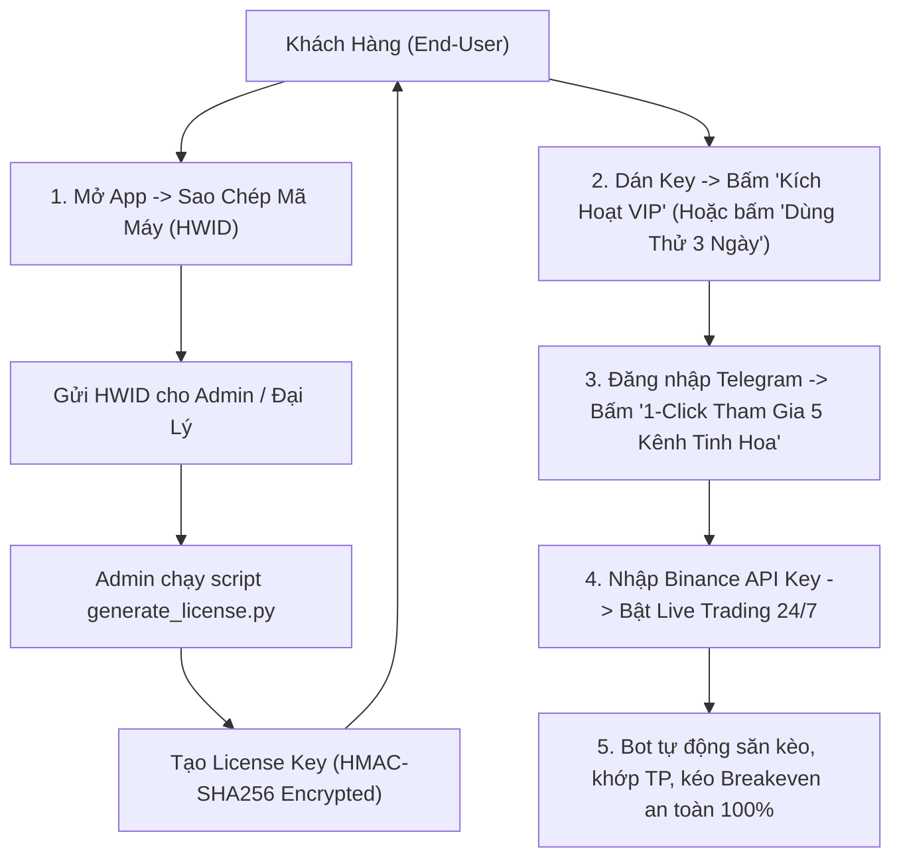

# HƯỚNG DẪN THƯƠNG MẠI HÓA & PHÁT HÀNH PHẦN MỀM (COMMERCIAL SUITE v1.3.1)

Tài liệu này hướng dẫn chi tiết cách vận hành giải pháp thương mại hóa phần mềm **Telegram Binance Signal Executor**, bao gồm hệ thống khóa bản quyền phần cứng (HWID-Locked License), cơ chế dùng thử 1-click, tính năng tự động tham gia 5 nhóm tinh hoa Telegram (1-Click Auto-Join) và quy trình build bộ cài Windows `.exe`.

---

## 1. TỔNG QUAN KIẾN TRÚC THƯƠNG MẠI



---

## 2. DÀNH CHO ADMIN: CÁCH TẠO KEY BẢN QUYỀN CHO KHÁCH

Hệ thống cung cấp CLI script chuyên dụng: `scripts/generate_license.py`.

### A. Cú pháp sinh Key theo nhu cầu khách hàng:

1. **Cấp Key VIP Vĩnh Viễn (Lifetime):**
```bash
python scripts/generate_license.py --hwid HWID-XXXX-XXXX-XXXX-XXXX --lifetime
```

2. **Cấp Key VIP Theo Năm (365 ngày):**
```bash
python scripts/generate_license.py --hwid HWID-XXXX-XXXX-XXXX-XXXX --days 365 --plan VIP_YEARLY
```

3. **Cấp Key VIP Theo Tháng (30 ngày):**
```bash
python scripts/generate_license.py --hwid HWID-XXXX-XXXX-XXXX-XXXX --days 30 --plan VIP_MONTHLY
```

4. **Cấp Key Dùng Thử Riêng Biệt (7 ngày):**
```bash
python scripts/generate_license.py --hwid HWID-XXXX-XXXX-XXXX-XXXX --days 7 --plan TRIAL_SPECIAL
```

5. **Tạo Key Dùng Chung Cho Mọi Máy (Master Demo Key):**
```bash
python scripts/generate_license.py --hwid ANY --days 30 --plan MASTER_DEMO
```

> [!NOTE]
> Key tạo ra có dạng `VIP-eyJuYW1lIjoi...`. Khách hàng chỉ cần dán chuỗi này vào giao diện và bấm **"Kích Hoạt Key"**. Mỗi Key đã được ký số HMAC-SHA256 bí mật, chống làm giả, chống can thiệp và không thể chia sẻ sang máy khác nếu không đúng HWID.

---

## 3. DÀNH CHO KHÁCH HÀNG: TRẢI NGHIỆM NGƯỜI DÙNG 1-CLICK

### Bước 1: Kích hoạt bản quyền hoặc dùng thử
- Trên thanh Header của ứng dụng, bấm vào huy hiệu `[👑 KÍCH HOẠT VIP]`.
- Popup **Quản Lý Bản Quyền VIP** sẽ hiện ra:
  - Khách bấm nút **"Sao Chép"** tại ô **Mã Định Danh Máy (Machine HWID)** rồi gửi cho bạn để nhận Key VIP.
  - **Dùng Thử Nhanh:** Nếu khách muốn trải nghiệm ngay lập tức, chỉ cần bấm nút **"Dùng Thử Miễn Phí 3 Ngày"** (1-Click). Hệ thống tự động cấp phép dùng thử 72 giờ không cần nhập key, đồng thời ghi nhận dấu vân tay chống kích hoạt lại nhiều lần.

### Bước 2: Tự động tham gia 5 nhóm tinh hoa Telegram (1-Click Auto-Join)
- Khách vào tab **Kết nối (Connections)** -> Nhập SĐT và OTP Telegram.
- Ngay sau khi kết nối thành công, xuất hiện hộp thoại:
  `⚡ Tham Gia Nhanh 5 Kênh Tinh Hoa (1-Click Auto-Join)`.
- Khách chỉ cần bấm **"Tham Gia 5 Kênh Ngay"**:
  - Bot tự động tham gia cả 5 kênh:
    1. **THE WOLF (CRYPTO)®** (`-1002007658025`)
    2. **Boom_Boom_Billionaires** (`-1001756316676`)
    3. **CRYPTO LEOPARD'S** (`-1002052872813`)
    4. **CRYPTO MONK** (`-1001552004524`)
    5. **Crypto Neon** (`-1001370457350`)
  - Tự động kích hoạt whitelist giám sát tín hiệu cho 5 kênh này trong danh sách quét. Khách không cần phải tự đi tìm hay ấn join từng link một!

### Bước 3: Kết nối Binance API & Bật Live Trading
- Khách nhập `Binance API Key` & `API Secret` (Quyền Futures Trading, tuyệt đối KHÔNG cần quyền Rút tiền).
- Bật công tắc `Giao dịch Live`.
- Hệ thống tự động thiết lập đòn bẩy an toàn (`Safe Leverage Clamp`), quản lý vốn tối đa 2% rủi ro, và kích hoạt `Breakeven` tự động khi chạm TP1.

---

## 4. QUY TRÌNH BUILD BỘ CÀI WINDOWS NSIS SETUP (.EXE)

Khi cần phát hành phiên bản mới cho khách hàng:

```powershell
# 1. Biên dịch frontend React/Vite
cd desktop
npm.cmd run build

# 2. Đóng gói Backend Python độc lập (PyInstaller)
cd ..
pyinstaller --clean -y backend-x86_64-pc-windows-msvc.spec
copy dist\backend-x86_64-pc-windows-msvc.exe desktop\src-tauri\binaries\
copy dist\backend-x86_64-pc-windows-msvc.exe desktop\src-tauri\binaries\backend.exe

# 3. Đóng gói bộ cài Windows NSIS Setup
cd desktop\src-tauri
cargo tauri build --bundles nsis
```

**File cài đặt đầu ra gửi cho khách:**
`desktop/src-tauri/target/release/bundle/nsis/telegram-binance-signal-executor_1.3.1_x64-setup.exe`

Khách hàng chỉ cần tải file này về, nhấn `Next -> Next -> Finish` là phần mềm sẵn sàng hoạt động!

