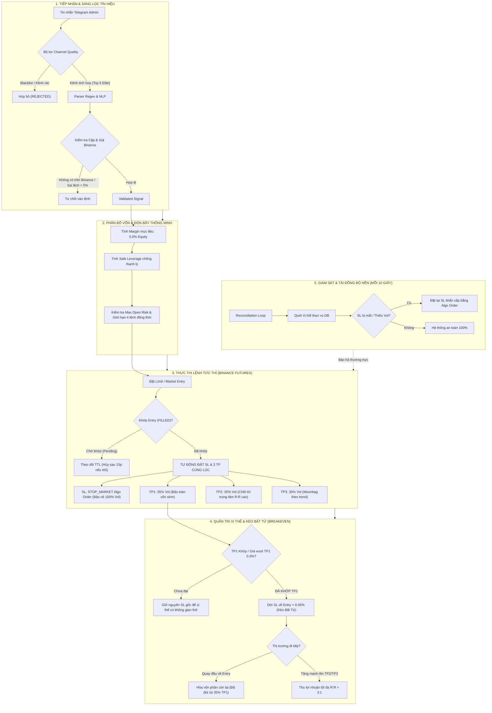

# 🗺️ HỆ THỐNG MINDMAP CHIẾN LƯỢC & TĂNG TRƯỞNG TÀI KHOẢN CRYPTO FUTURES (BINANCE)
> **Tài liệu chuẩn hóa kiến trúc giao dịch, quản trị rủi ro tuyệt đối và khắc phục triệt để các bẫy thua lỗ**  
> *Phiên bản:* 2.0 (Tháng 10/2026) — *Mục tiêu:* Tăng trưởng vốn thực chiến an toàn, R:R dương bền vững.

---

## 1. TỔNG QUAN & NGUYÊN TẮC BẤT DI BẤT DỊCH (CORE PRINCIPLES)

1. **Bảo toàn vốn tuyệt đối (Zero Liquidation Risk):** Khoảng cách giá thanh lý luôn phải xa hơn Stop Loss ít nhất 300%. Đòn bẩy tối đa tự động khóa theo công thức:
   $$\text{Leverage}_{\max} = \min\left(\text{PolicyMax}, \left\lfloor \frac{0.75}{\text{SL\_Distance\_Pct}} \right\rfloor\right)$$
2. **Tỷ lệ R:R dương thực tế ($\ge 2.5 : 1$):** Không chấp nhận kịch bản "Ăn vài xu, thua cả đô". Một lệnh thắng chuẩn (chạm TP2/TP3) phải bù đắp ít nhất 2 đến 3 lệnh thua SL.
3. **Chống ảo giác lợi nhuận (Anti-Hallucination):** Toàn bộ tín hiệu từ các Admin Telegram phải được đối chiếu trực tiếp với sổ lệnh, giá nến và cặp giao dịch thực tế trên Binance USDT-M Futures.
4. **Cô lập dữ liệu lịch sử:** Dữ liệu quét lịch sử (backtest/ranking) tuyệt đối không được cấp trạng thái `VALIDATED` để tránh gây nhiễu cho luồng đối soát lệnh trực tiếp (Reconciliation).

---

## 2. MINDMAP TOÀN DIỆN KIẾN TRÚC GIAO DỊCH



---

## 3. BẢNG CHI TIẾT 7 CẠM BẪY GÂY LỖ VÀ GIẢI PHÁP TRIỆT ĐỂ

| STT | Bẫy Sai Lầm Quá Khứ | Nguyên Nhân Gốc Rễ | Hậu Quả Thực Tế | Giải Pháp Đã Khắc Phục Triệt Để |
|:---:|:---|:---|:---|:---|
| **1** | **Nhiễm độc tín hiệu cũ (Historical Poisoning)** | Quét 1,721 tin nhắn cũ lưu trạng thái `VALIDATED`. Vòng Reconciliation nạp nhầm tín hiệu BAT từ 6 tháng trước. | Khi lệnh BAT thật vừa mở ở $0.1835, bot thấy TP1 cũ $0.08 đã qua nên dời SL hòa vốn sau 30 giây, bị râu nến quét văng với +$0.01. | 1. Tự động chuyển toàn bộ tín hiệu lịch sử sang `CLOSED`.<br>2. Reconciliation lọc cứng `ORDER BY created_at DESC LIMIT 1 per symbol` và chỉ chấp nhận tín hiệu có lệnh thực tế. |
| **2** | **Bóp nghẹt lợi nhuận (Profit Asphyxiation)** | Chốt tới 60% ở TP1, rồi dời SL về sát mép Entry ngay khi giá vừa chạm nhẹ TP1. | Ăn được phần nhỏ tí ti, mất cơ hội ăn sóng lớn TP2/TP3, biến tỷ lệ R:R thành âm nặng nề. | Chuyển tỷ lệ TP thành **35% (TP1) - 35% (TP2) - 30% (TP3)**. Chỉ dời Breakeven khi TP1 đã khớp thực tế hoặc giá đã vượt qua TP1 tối thiểu 0.3%. |
| **3** | **Margin quá nhỏ so với phí & SL** | Cài `target_margin_pct: 1.5%` ($1.24/lệnh). Lệnh thắng TP1 ăn +$0.20, lệnh thua dính trọn SL lỗ -$1.30. | Thắng 5 lệnh liên tiếp cũng bị 1 lệnh thua xóa sạch thành quả. Cần winrate >85% mới hòa vốn. | Nâng Target Margin lên chuẩn **5.0%** ($4.15 - $5.00/lệnh cho 5 nhóm tinh hoa, 2.5% cho nhóm phụ). Vẫn bảo toàn 0% rủi ro cháy, nhưng lệnh thắng ăn +$2.50 đến +$7.50, áp đảo hoàn toàn lệnh thua. |
| **4** | **Ảo giác lãi từ kênh Admin (Fake PnL / Sàn Khác)** | Admin trade trên Bybit/Bitget hoặc vẽ ảnh lãi ảo; râu nến và độ trượt giá sàn khác xa Binance. | Theo lệnh bị dính SL trên Binance trong khi Admin khoe ảnh TP3 trên Bybit. | 1. Kiểm tra chênh lệch giá thời gian thực trên Binance.<br>2. Blacklist vĩnh viễn các nhóm có tỷ lệ vẽ kèo hoặc lệch giá quá 3%. |
| **5** | **Kiểm tra sai trường Algo Order (`origQty` vs `quantity`)** | Binance trả về trường `quantity` trong API `/fapi/v1/openAlgoOrders` thay vì `origQty`. Code cũ kiểm tra `not a.get("origQty")` dẫn đến nhận định sai. | Bot tưởng vị thế chưa có SL, liên tục hủy và đặt lại lệnh làm rối loạn luồng lệnh. | Sửa hàm kiểm tra bao quát cả `quantity` lẫn `origQty`, kiểm tra chính xác tổng khối lượng SL bao phủ 100% vị thế. |
| **6** | **Dời SL khi giá thị trường đã tụt dưới Entry** | Khi giá giật ngược về dưới Entry mà lệnh dời Breakeven mới gửi đi, Binance biến lệnh Stop Market thành Market Order khớp lỗ ngay. | Lệnh vừa dời hòa vốn đã lập tức bị khớp thành lệnh bán tháo ở giá xấu. | Bổ sung điều kiện `price_favorable_for_be`: Giá hiện tại phải cao hơn giá Entry ít nhất +0.2% (đối với Long) mới cho phép kích hoạt dời SL. |
| **7** | **Không bảo vệ kịp thời sau khi khớp DCA** | Admin cho 2 Entry. Khi Entry 2 khớp, khối lượng tăng gấp đôi nhưng SL vẫn ở khối lượng cũ. | Rủi ro bị lộ 50% khối lượng không có Stop Loss bảo vệ. | Reconciliation tự động so sánh `abs(positionAmt)` với tổng `total_sl_qty`. Nếu thiếu khối lượng, tự động tái đồng bộ SL đủ 100% khối lượng mới. |

---

## 4. CHIẾN LƯỢC PHÂN BỔ LỜI & QUẢN LÝ VỊ THẾ BẤT TỬ

### Tỷ Lệ Chốt Lời Vàng (35% - 35% - 30%)
- **TP1 (35% Khối lượng):** Mục tiêu ngắn (1.5% - 2.5% giá). Vai trò: Đút túi lợi nhuận đầu tiên, trang trải toàn bộ phí sàn và bảo vệ tâm lý.
- **TP2 (35% Khối lượng):** Mục tiêu trung bình (4.0% - 7.0% giá). Vai trò: Trọng tâm tạo lợi nhuận chính cho tài khoản, đưa R:R của cả kèo lên $> 2:1$.
- **TP3 (30% Khối lượng):** Mục tiêu dài (10% - 25% giá hoặc gồng trend). Vai trò: Bắt trọn những cú pump/dump bùng nổ mà không sợ rủi ro vì đã có Breakeven bảo vệ.

### Cơ Chế "Kèo Bất Tử" (Risk-Free Breakeven)
```
          [ENTRY] ─────────────────────► [TP1 Hit (+2%)] ────► [TP2 Hit (+5%)] ────► [TP3 Hit (+10%)]
             │                                   │
      SL Gốc (-3%)                     SL dời lên: [ENTRY + 0.05%]
   (Rủi ro tối đa: $0.90)                 (Rủi ro = 0%, Lợi nhuận đã khóa: +$0.50)
```
1. Ngay khi TP1 khớp thành công, hệ thống tự động:
   - Hủy lệnh SL cũ.
   - Đặt lệnh Stop Market mới tại mức: $\text{Entry Price} \times (1 \pm 0.0005)$ (Bù đắp trọn vẹn phí vào + ra lệnh).
2. Từ giây phút này trở đi, giao dịch chính thức trở thành **"Kèo Bất Tử"**:
   - Trường hợp xấu nhất (quay đầu): Lãi nhẹ tiền TP1, phần còn lại đóng hòa vốn.
   - Trường hợp tốt nhất: Ăn trọn vẹn cả TP2 và TP3 với khối lượng 65% còn lại.

---

## 5. BẢNG TÍNH TOÁN DỰ PHÓNG LỢI NHUẬN TRÊN TÀI KHOẢN $82 USDT (CHUẨN HÓA VỐN TOP 5 ELITE)

Cơ chế phân bổ vốn chuẩn hóa tập trung nguồn lực vào Top 5 Nhóm Tinh Hoa:
- **Nhóm Tinh Hoa (Top 5 Elite Channels):** Đi lệnh chuẩn **5.0% tài khoản** (~$4.15 - $5.00 USDT ký quỹ cho vốn nhỏ $82, hoặc theo tỷ lệ vốn thực tế).
- **Nhóm Thử Nghiệm / Phụ (Nếu có cấu hình riêng):** Đi lệnh dự phòng **2.5% tài khoản** (~$2.07 - $2.50 USDT ký quỹ).

| Thông số | Kịch Bản Cũ (Quá An Toàn / R:R Âm) | Kịch Bản Phụ / Thử Nghiệm (2.5%) | Kịch Bản Chuẩn: Nhóm Tinh Hoa (5.0%) |
|:---|:---:|:---:|:---:|
| **Margin ký quỹ mỗi lệnh** | 1.5% ($1.24) | **2.5% ($2.07 - $2.50)** | **5.0% ($4.15 - $5.00)** |
| **Đòn bẩy an toàn chuẩn** | 10x | **11x - 25x (Chuẩn 20x)** | **11x - 25x (Chuẩn 20x)** |
| **Giá trị vị thế (Notional)** | ~$15 - $20 USDT | **~$40 - $50 USDT** | **~$80 - $100 USDT** |
| **Độ phủ Binance Min Notional** | Đạt ($5 min) | **Vượt xa 8x ($40 > $5)** | **Vượt xa 16x ($80 > $5)** |
| **Chốt ở TP1 (Khối lượng)** | 60% vị thế | **35% vị thế** | **35% vị thế** |
| **Lợi nhuận khi chạm TP1** | +$0.18 USDT | **+$0.45 USDT** | **+$0.90 USDT** |
| **Lợi nhuận khi chạm TP2 & TP3** | +$0.15 USDT | **+$2.20 - $3.80 USDT** | **+$4.50 - $7.50 USDT** |
| **Tổng lãi 1 lệnh chuẩn** | +$0.33 USDT | **+$2.65 - $4.25 USDT** | **+$5.40 - $8.40 USDT** |
| **Khoản lỗ nếu chạm SL (-3.0%)** | -$1.25 USDT | **-$1.03 USDT** | **-$2.07 USDT** |
| **Tỷ lệ Risk : Reward** | **1 : 0.26 (Rất xấu)** | **1 : 2.50 đến 1 : 4.00** | **1 : 2.50 đến 1 : 4.00** |
| **Winrate cần để hòa vốn** | > 80% | **Chỉ cần > 25%** | **Chỉ cần > 25%** |
| **Dự phóng 20 lệnh (Winrate 55%)** | **Âm -$4.80 USDT** | **Dương +$22.00 đến +$32.00 USDT** | **Dương +$45.00 đến +$65.00 USDT (+65% vốn)** |

---

### 5.1 QUY TẮC ĐÒN BẨY VÀNG (11x – 25x OPTIMAL LEVERAGE SYSTEM)

Nhằm tối ưu hóa hiệu quả sử dụng vốn nhỏ ($82) mà vẫn triệt tiêu hoàn toàn rủi ro cháy tài khoản:
1. **Dải Đòn Bẩy Chuẩn: 11x – 25x (Mặc định 20x):**
   - Khi Admin ghi dải (VD: `10x – 50x` hoặc `20x – 50x`): Hệ thống chọn điểm ngọt tối ưu **20x** (thay vì ghìm ở đáy 10x như trước).
   - Khi Admin ghi số cụ thể (VD: `15x`, `20x`, `25x`): Hệ thống tôn trọng và đi chuẩn theo yêu cầu của Admin.
   - Khi Admin không ghi đòn bẩy: Hệ thống tự động áp dụng đòn bẩy chuẩn **20x**.
   - Trần tối đa: Toàn bộ các kênh Whitelist được nâng trần lên **25x** (chặn các đòn bẩy ảo nguy hiểm như 50x, 100x).
2. **Chốt Chặn Chống Thanh Lý Tuyệt Đối (Zero Liquidation Safe Clamp):**
   $$\text{Safe Leverage} = \min\left(25, \left\lfloor \frac{0.75}{\text{Khoảng cách SL \%}} \right\rfloor\right)$$
   - Khoảng cách SL $\le 3.7\% \rightarrow$ Đi đủ **20x – 25x**.
   - Khoảng cách SL $4.0\% – 5.0\% \rightarrow$ Đi **15x – 18x**.
   - Khoảng cách SL $6.0\% – 7.5\% \rightarrow$ Tự động hạ về **10x – 12x** (như kèo GTC để bảo vệ vốn trước râu nến).
   - Khoảng cách SL $> 10\% \rightarrow$ Tự động hạ về **6x** (như kèo BAT để giá thanh lý luôn xa hơn Stop Loss).

---

## 6. DANH MỤC NHÓM & MA TRẬN PHÂN LOẠI THỰC THI (CHANNEL MATRIX v1.3.3)

Hệ thống khóa cứng bộ lọc chỉ thực thi tín hiệu từ Top 5 Kênh Tinh Hoa, cô lập và chặn vĩnh viễn các nhóm rác ngoài whitelist:

### Nhóm 1: Top 5 Kênh Tinh Hoa (Elite Channels - Margin 5.0%, multiplier = 1.0)
- Đặc điểm: Tín hiệu có SL/TP bài bản, tỷ lệ thắng thực tế trên sàn cao ($> 65\%$), tần suất chọn lọc, không xóa tin nhắn thua:
  1. `THE WOLF (CRYPTO)®` (ID: `-1002007658025`): Kèo swing R:R dương lớn, TP dải gạch nối.
  2. `Boom_Boom_Billionaires` (ID: `-1001756316676`): Winrate 75%, dời hòa vốn Kèo Bất Tử siêu tốc.
  3. `CRYPTO LEOPARD'S` (ID: `-1002052872813`): Winrate 79.5%, bắt vùng giá BELOW cực tốt.
  4. `CRYPTO MONK` (ID: `-1001552004524`): Kèo Scalp nhanh, áp dụng chính sách ngoại lệ `#SHORT / BUY : 1)`.
  5. `Crypto Neon` (ID: `-1001370457350`): Kỷ luật thép, biên SL 5%, đòn bẩy kẹp an toàn 10x.
- **Chính sách:** Cấp đủ 100% hạn mức rủi ro chuẩn (Target Margin: 5.0%, Margin Cap: 7.0%, Risk Budget: 2.5%).

### Nhóm 2: Các Kênh Bị Thanh Lọc & Blacklist Vĩnh Viễn (Hủy lệnh lập tức - Margin 0%)
- Toàn bộ 13 kênh cũ đã bị xóa sạch khỏi cơ sở dữ liệu và bị chặn vĩnh viễn để bảo vệ tài khoản:
  1. `Global Crypto Research` (`-1001161683441`): Quá nhiều tin vĩ mô và quảng cáo sàn làm loãng tín hiệu.
  2. `Crypto spider scalper` (`-1001895315984`): Tần suất quá dày, tỷ lệ quét SL cao.
  3. `THE MASTER (CRYPTO)` (`-1002266035358`): Vùng Entry Zone quá rộng, dễ bị trượt giá.
  4. `Crypto Pulse Matrix®` (`-1001966506182`): Tỷ lệ tin rác và câu view cao.
  5. `Crypto Hunters` (`-1002191067035`): Tỷ lệ quét SL thực tế lên tới 77.5%.
  6. `Alpha Trade Zone` (`-1001860630181`): Cú pháp không nhất quán, giấu số liệu cắt lỗ.
  7. `Crypto World Updates` (`-1001652601224`): Tỷ lệ R:R âm, không tối ưu cho tài khoản nhỏ.
  8. `ESTR - EAT SLEEP TRADE REPEAT` (`-1001656921849`): Lỗi template đảo ngược SL/TP thường xuyên.
  9. Các kênh còn lại: Thường xuyên xóa tin nhắn khi thua hoặc bắn coin rác thiếu thanh khoản trên Binance.

---

## 7. QUY TRÌNH HÀNH ĐỘNG HẰNG NGÀY CHO AGENT & HỆ THỐNG

1. **Đầu ngày (07:00 UTC+7):**
   - Chạy hàm kiểm tra đối soát số dư và các vị thế mở trên Binance (`/fapi/v1/positionRisk`).
   - Xác nhận cơ sở dữ liệu sạch sẽ, không có tín hiệu mồ côi dạng `VALIDATED`.
2. **Trong phiên giao dịch:**
   - Khi có tin mới: Parser phân tích -> Validator kiểm tra giá sàn -> Risk Engine tra cứu `chat_id` -> Phân bổ Margin 5.0% (Top 5 Elite) hoặc 2.5% (Thử nghiệm).
   - Luồng Reconciliation nền chạy mỗi 10 giây để đảm bảo 100% vị thế mở đều có SL bảo vệ bằng Algo Order.
   - Khi TP1 khớp: Kích hoạt Kèo Bất Tử, dời SL lên Entry + 0.05%, thả phần 65% còn lại tự do chạy đến TP2 (35%) và TP3 (30%).
3. **Cuối ngày (23:00 UTC+7):**
   - Tổng kết PnL thực tế từ Binance `/fapi/v1/income` (không dựa vào ảnh chụp hay tuyên bố của Admin).
   - Đánh giá kênh nào cho lợi nhuận thực dương và kênh nào gây lỗ để duy trì chất lượng Top 5 Elite.

