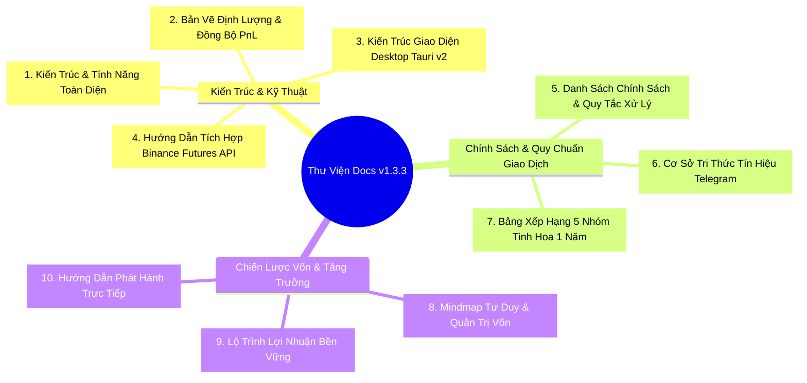

# THƯ VIỆN TÀI LIỆU HỆ THỐNG (MASTER DOCUMENTATION INDEX)
## TELEGRAM BINANCE SIGNAL EXECUTOR (v1.3.3 PRO)

Chào mừng bạn đến với trung tâm tài liệu toàn diện của dự án **Telegram Binance Signal Executor**. Thư mục này tập hợp, hệ thống hóa và lưu trữ toàn bộ các tài liệu kỹ thuật, đặc tả kiến trúc, quy chuẩn chính sách giao dịch, cơ sở tri thức tín hiệu và lộ trình quản trị vốn.

---

### 🗺️ BẢN ĐỒ ĐIỀU HƯỚNG TÀI LIỆU (DOCUMENTATION SITEMAP)

---

### 📚 CHI TIẾT TỪNG TÀI LIỆU & MỤC ĐÍCH SỬ DỤNG

#### 1. Kiến trúc & Vận hành Cốt lõi
* **[`SYSTEM_ARCHITECTURE_AND_FEATURE_SPEC.md`](./SYSTEM_ARCHITECTURE_AND_FEATURE_SPEC.md):**  
  *Tài liệu đầu não của toàn bộ hệ thống.* Trình bày chi tiết kiến trúc 3 tầng (Rust Supervisor, React 19 UI, Python Backend), cơ chế xử lý ngoại lệ, nhật ký phát triển 26 bản vá/tính năng từ v1.1.7 đến v1.3.2, và quy trình vận hành chuẩn SOP.
* **[`SYSTEM_QUANT_ARCHITECTURE.md`](./SYSTEM_QUANT_ARCHITECTURE.md):**  
  *Bản vẽ kiến trúc định lượng và luồng số liệu.* Mô hình hóa luồng dữ liệu đối soát PnL thời gian thực giữa các endpoint của Binance (`/userTrades`, `/income`) với bộ nhớ đệm TTL và giao diện người dùng.
* **[`DESKTOP_UI_ARCHITECTURE.md`](./DESKTOP_UI_ARCHITECTURE.md):**  
  *Kiến trúc phần mềm Desktop Shell.* Chi tiết 11 màn hình quản lý, giao tiếp IPC nội bộ, cấu hình cửa sổ Tauri v2, quy trình biên dịch và đóng gói bộ cài Windows NSIS.
* **[`DOCUMENTATION_BINANCE_API.md`](./DOCUMENTATION_BINANCE_API.md):**  
  *Cẩm nang tích hợp Binance USD-M Futures.* Quy định nghiêm ngặt về việc gửi lệnh điều kiện (SL/TP) qua endpoint `/algoOrder` (tránh lỗi -4120), định dạng số thực chống lỗi ký hiệu khoa học (`_format_decimal`), đệm an toàn Breakeven 0.1% tick_size, tự động bù lệch giờ máy chủ (-1021) và quy trình ngắt mạch khẩn cấp Fail-Safe.

#### 2. Quy tắc Giao dịch & Tín hiệu Telegram
* **[`POLICY_SPECIFICATION.md`](./POLICY_SPECIFICATION.md):**  
  *Luật chơi và kỷ luật giao dịch thép.* Đặc tả chi tiết chính sách chọn giá Entry (Best Price), phân bổ chốt lời hàm mũ Geometric Decay (35/35/30), cơ chế bảo toàn số dư coin lẻ TP cuối (Anti-Dust Remainder), cơ chế dời hòa vốn Kèo Bất Tử và công thức kẹp đòn bẩy an toàn Safe Leverage Clamp.
* **[`channel_signal_knowledge_base.md`](./channel_signal_knowledge_base.md):**  
  *Cơ sở tri thức tín hiệu thực chiến.* Kết quả phân tích hơn 25.000 tin nhắn trong 6 tháng, ma trận lọc rác/quảng cáo sàn/VIP bait, và hướng dẫn bóc tách cú pháp riêng biệt của 5 nhóm tinh hoa.
* **[`CHANNEL_RANKING_1_YEAR.md`](./CHANNEL_RANKING_1_YEAR.md):**  
  *Báo cáo thẩm định kênh 1 năm.* Thống kê winrate, số lượng lệnh, tỷ lệ R:R và lý do phân hạng Tier S (The Wolf, Boom Boom, Leopard), Tier A (Monk, Neon) và Blacklist các kênh khoe lãi ảo.

#### 3. Quản trị Vốn, Tâm lý & Phát hành
* **[`CRYPTO_TRADING_MINDMAP_AND_GROWTH_SYSTEM.md`](./CRYPTO_TRADING_MINDMAP_AND_GROWTH_SYSTEM.md):**  
  *Bản đồ tư duy toàn diện cho nhà đầu tư.* Hướng dẫn phân bổ vốn chi tiết theo từng quy mô tài khoản (3 triệu, 10 triệu, 100 triệu, 1 tỷ VNĐ), mô hình két sắt 2 ngăn và công thức duy trì 80% vốn tiền mặt dự phòng.
* **[`SUSTAINABLE_PROFIT_ROADMAP.md`](./SUSTAINABLE_PROFIT_ROADMAP.md):**  
  *Chiến lược đường dài & Sức mạnh lãi kép.* Hướng dẫn đặt mục tiêu lợi nhuận thực tế (15% - 30%/tháng), quy trình đánh giá hiệu suất định kỳ 30 ngày và kỷ luật không can thiệp lệnh tay.
* **[`COMMERCIAL_LICENSE_GUIDE.md`](./COMMERCIAL_LICENSE_GUIDE.md):**  
  *Hướng dẫn phân phối & Triển khai nhanh.* Hướng dẫn khách hàng cài đặt app từ file setup độc lập, tự động tham gia 5 nhóm tinh hoa bằng 1 click mà không cần server bản quyền phức tạp.

---

### 🚀 HƯỚNG DẪN DÀNH CHO LẬP TRÌNH VIÊN & NGƯỜI VẬN HÀNH

1. **Khi phát triển tính năng mới:** Luôn đọc trước [`POLICY_SPECIFICATION.md`](./POLICY_SPECIFICATION.md) và [`DOCUMENTATION_BINANCE_API.md`](./DOCUMENTATION_BINANCE_API.md) để đảm bảo không vi phạm các chốt chặn an toàn vốn.
2. **Khi thêm/sửa bộ phân tích cú pháp kênh mới:** Tham khảo các mẫu regex và ma trận lọc rác tại [`channel_signal_knowledge_base.md`](./channel_signal_knowledge_base.md).
3. **Khi đóng gói bản phát hành:** Tuân thủ quy trình build NSIS tại [`DESKTOP_UI_ARCHITECTURE.md`](./DESKTOP_UI_ARCHITECTURE.md) và chạy kiểm thử đầy đủ `pytest tests/ -v`.

