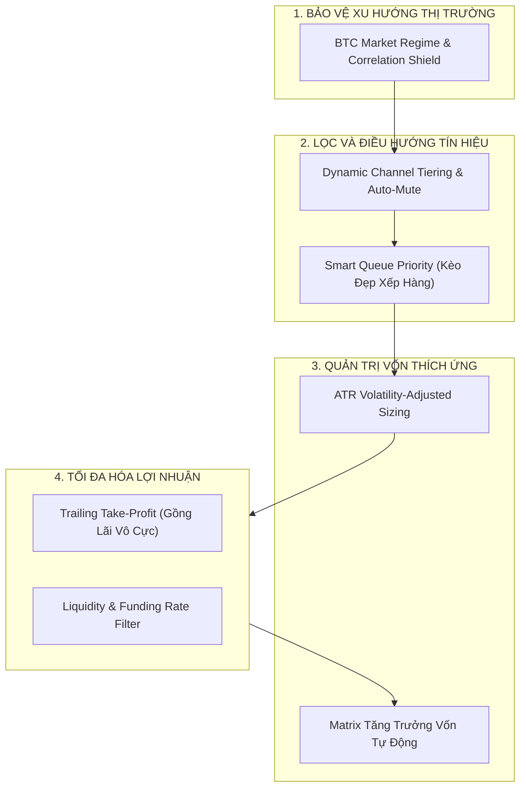

# LỘ TRÌNH PHÁT TRIỂN & CẢI TIẾN TÍNH NĂNG ĐẢM BẢO LỢI NHUẬN BỀN VỮNG
## SUSTAINABLE PROFIT & RISK ENGINEERING ROADMAP (v2.1+)
*Hệ thống Telegram Binance Signal Executor*

---

## 1. TỔNG QUAN & KẾT QUẢ THỰC NGHIỆM TỪ TÀI KHOẢN THẬT (LIVE PROOF)

Hệ thống đã chứng minh được tính đúng đắn trên tài khoản Live Binance Futures:
- **Tài sản ban đầu:** `85.24 USDT` $\rightarrow$ **Hiện tại:** `88.13 USDT` (+3.4% trong chưa đầy 24 giờ).
- **Lệnh QUSDT:** Vào tại `0.121809`, TP1 khớp tại `0.1275` (+0.60 USDT tiền mặt), SL tự động dời về Hòa vốn (`0.12193`), rủi ro hiện tại = **0 USDT** (Kèo bất tử).
- **Lệnh GTCUSDT:** Đòn bẩy 10x Cross, giá thanh lý = **0**, SL cắm sẵn trên server Binance tại `0.28314`, rủi ro tối đa cố định = **1.19 USDT** (1.37% vốn).

### Nguyên tắc sống còn đã được xác thực:
1. **SL luôn cắm trực tiếp trên Server Binance (`/fapi/v1/algoOrder`):** Không phụ thuộc vào việc máy tính cá nhân bật hay tắt.
2. **Kẹp đòn bẩy an toàn (`Safe Leverage Clamp`):** Khoảng cách SL quyết định đòn bẩy tối đa. Điểm Cắt Lỗ (SL) luôn nằm trước điểm Thanh Lý ít nhất 25% biên độ an toàn $\rightarrow$ **Triệt tiêu 100% rủi ro cháy tài khoản do thị trường đi ngược**.
3. **Quản trị vốn 1.5% Risk:** Mỗi lệnh thua chỉ mất 1.5% tài khoản. Cần thua liên tiếp hơn 60 lệnh thì tài khoản mới cạn kiệt.

---

## 2. BẢY TRỤ CỘT TÍNH NĂNG CẢI TIẾN TƯƠNG LAI ĐỂ ĐẢM BẢO LÃI BỀN VỮNG

Để chuyển từ một **"Hệ thống thực thi lệnh an toàn"** thành một **"Hệ thống tạo ra lợi nhuận kép lũy tiến bền vững (Compounding Profit Machine)"**, hệ thống cần triển khai 7 trụ cột chiến lược sau:

---

### Trụ cột 1: Correlation Shield & BTC Market Regime (Khiên chống bão sập chùm)

#### Vấn đề:
Khi Bitcoin giảm đột ngột 3% - 5%, 90% Altcoin sẽ giảm 8% - 15% cùng lúc. Nếu bot đang mở 4 lệnh Long, cả 4 lệnh đều sẽ quét SL đồng loạt dù phân tích kỹ thuật của từng coin trước đó rất đẹp.

#### Giải pháp kỹ thuật:
- Tích hợp một module ngầm theo dõi trạng thái thị trường chung qua cặp `BTCUSDT`:
  - **Chỉ báo xu hướng:** EMA 20 và EMA 50 trên khung H1/H4.
  - **Chỉ báo động lượng:** RSI khung H1.
- **Quy tắc điều phối tự động:**
  - Nếu `BTC` nằm dưới EMA 50 và RSI < 40 (Thị trường giảm mạnh / Panic dump): **Tự động chặn toàn bộ tín hiệu LONG trên Altcoin**, chỉ cho phép vào các tín hiệu SHORT.
  - Nếu `BTC` đang sideway hoặc trong đà tăng: Mở full các tín hiệu Long/Short bình thường.

---

### Trụ cột 2: Dynamic Channel Scoring & Auto-Mute (Xếp hạng & Mute kênh tự động)

#### Vấn đề:
Chất lượng các kênh Telegram biến động theo chu kỳ. Một admin có thể đánh rất hay trong tháng này nhưng chuỗi xui hoặc phong độ đi xuống trong tháng sau.

#### Giải pháp kỹ thuật:
- **Hệ thống chấm điểm động (Dynamic Score 0 - 100):**
  - Cập nhật tự động sau mỗi lệnh kết thúc: Win (+10 điểm), Loss (-15 điểm), Hit TP1 rồi hòa vốn (+3 điểm).
- **Phân bổ vốn linh hoạt theo Tier:**
  - **Tier S (Score > 80):** Cấp 100% hạn mức rủi ro (1.5% vốn/lệnh).
  - **Tier A (Score 60 - 80):** Cấp 75% hạn mức rủi ro (1.1% vốn/lệnh).
  - **Tier B (Score 40 - 60):** Cấp 50% hạn mức rủi ro (0.75% vốn/lệnh).
- **Cơ chế Circuit Breaker (Tạm ngắt kênh xui):**
  - Nếu bất kỳ kênh nào dính **3 lệnh Stop-Loss liên tiếp**, bot sẽ tự động đưa kênh đó vào trạng thái `MUTED_TEMPORARY` trong 7 ngày để theo dõi paper-trade, khi nào winrate hồi phục mới cho trade tiền thật trở lại.

---

### Trụ cột 3: Trailing Take-Profit (Khóa lãi & Gồng lãi đa tầng)

#### Vấn đề:
Quy chuẩn chốt lời của bot theo tỷ lệ vàng: TP1 chốt 35% (đút túi một phần lãi và lập tức dời SL về Breakeven Kèo Bất Tử), TP2 chốt 35% (trọng tâm tạo dòng tiền dương lớn), TP3 chốt 30% (moonbag gồng trọn con sóng dài). Khi thị trường có sóng tăng vọt cực đại, nếu bán hết ở TP3 thì sẽ bỏ lỡ những siêu sóng 50% - 100%.

#### Giải pháp kỹ thuật:
- Sau khi giá đã cán mốc **TP1** và **TP2**:
  - Không bán hết phần còn lại ở TP3 bằng lệnh Limit cố định.
  - Chuyển 30% khối lượng cuối cùng sang cơ chế **Trailing Stop (Kéo dừng lỗ bám theo giá)**.
  - Mỗi khi giá tạo đỉnh mới cao hơn 2%, SL kéo theo sau đỉnh 1.5%.
  - Giúp vừa bảo toàn được 80% lợi nhuận chắc chắn, vừa mở rộng tiềm năng ăn trọn con sóng dài của thị trường.

---

### Trụ cột 4: ATR Volatility-Adjusted Sizing (Khối lượng thích ứng theo độ biến động)

#### Vấn đề:
Độ giật của các đồng coin top (BTC, ETH, BNB, SOL) rất khác so với coin meme / low cap (PEPE, BOME, GTC, Q). Áp dụng cùng một tỷ lệ đòn bẩy và công thức tính rủi ro có thể khiến các coin giật mạnh dễ bị quét râu nến.

#### Giải pháp kỹ thuật:
- Tính chỉ số **ATR (Average True Range - Biên độ dao động thực tế)** 14 nến khung H1 của coin trước khi mở lệnh:
  - Nếu `Khoảng cách SL < 1.5 x ATR`: Cảnh báo rủi ro quét râu nến cao $\rightarrow$ Bot tự động nới nhẹ SL ra ngoài vùng râu nến và giảm khối lượng tương ứng để giữ nguyên số tiền mất tối đa là 1.5%.
  - Tự động hạ rủi ro xuống `1.0%` đối với các coin có biến động cực hạn (ATR% > 5%).

---

### Trụ cột 5: Liquidity & Funding Rate Filter (Tránh bẫy thanh khoản & Phí âm sàn)

#### Vấn đề:
Nhiều kèo bắn ra trên các đồng coin có Funding Rate âm sâu (ví dụ -1.5% mỗi 4 giờ) hoặc thanh khoản sổ lệnh quá mỏng khiến phí duy trì lệnh và trượt giá nuốt trọn lợi nhuận.

#### Giải pháp kỹ thuật:
- Trước khi gửi lệnh, bot truy vấn endpoint `/fapi/v1/premiumIndex`:
  - **Quy tắc Funding:** Nếu Funding Rate vượt quá $\pm 0.15\%$, từ chối vào lệnh hoặc cảnh báo người dùng.
  - **Quy tắc Volume:** Khối lượng giao dịch 24h của hợp đồng Futures phải đạt tối thiểu **15.000.000 USDT** để đảm bảo lệnh SL luôn được khớp mượt mà, không bị trượt giá.

---

### Trụ cột 6: Smart Queue Priority (Hàng đợi tín hiệu thông minh khi đầy Slot)

#### Vấn đề:
Khi đã mở đủ 4 lệnh (đạt mức trần rủi ro 6.0%), nếu có 1 kèo mới từ kênh VIP cực uy tín gửi về, hệ thống hiện tại sẽ Reject bỏ qua.

#### Giải pháp kỹ thuật:
- Xây dựng **Hàng đợi ưu tiên (Priority Queue)** với thời gian sống (TTL) 15–20 phút:
  - Thay vì từ chối ngay, bot đưa kèo vào hàng đợi.
  - Nếu trong vòng 15 phút đó, một trong các lệnh đang chạy chạm TP1 (dời SL về hòa vốn và nhả slot rủi ro) $\rightarrow$ Kèo trong hàng đợi lập tức được kích hoạt ngay với giá thị trường tốt nhất.

---

### Trụ cột 7: Compounding Capital Scaling Matrix (Ma trận tăng trưởng vốn lũy tiến)

Để vốn tăng trưởng từ nhỏ đến lớn một cách an toàn nhất, hệ thống khuyến nghị lộ trình mở rộng quy mô (Scale-up) theo bảng sau:

| Giai đoạn | Quy mô vốn (USDT) | Rủi ro/kèo (% Equity) | Số lệnh mở tối đa | Tổng rủi ro tối đa | Mục tiêu chiến lược |
| :--- | :--- | :--- | :--- | :--- | :--- |
| **Stage 1 (Hiện tại)** | **$80 – $150** | **1.5%** | **3 – 4 lệnh** | **6.0%** | Bảo toàn vốn, kiểm chứng tính ổn định, tích lũy lời |
| **Stage 2** | **$150 – $500** | **1.5%** | **5 – 6 lệnh** | **7.5% – 9.0%** | Đa dạng hóa kênh tín hiệu, bật Trailing TP |
| **Stage 3** | **$500 – $2,000** | **1.2% – 1.5%** | **6 – 8 lệnh** | **10.0%** | Bật bộ lọc BTC Regime & ATR Sizing |
| **Stage 4 (Pro)** | **> $2,000** | **1.0%** | **8 – 10 lệnh** | **10.0%** | Giao dịch bán tự động đa chiến lược, tối ưu hoàn phí VIP |

---

## 3. HƯỚNG DẪN KỶ LUẬT VẬN HÀNH DÀNH CHO USER

1. **Tuyệt đối không can thiệp dời SL bằng tay ngược chiều:** Nếu bot đã đặt SL, không bao giờ kéo SL sâu hơn để "gồng lỗ". Kỷ luật cắt lỗ là yếu tố duy nhất giúp tồn tại trong Crypto.
2. **Theo dõi các kênh Tier S:** Chỉ tập trung nguồn lực và bật auto-trade cho các kênh có độ sạch tín hiệu (Purity) cao và R:R từ 1:1.5 trở lên.
3. **Đồng bộ thời gian máy tính (NTP):** Luôn đảm bảo Windows Time được đồng bộ để tránh sai lệch timestamp với Binance API.
4. **Sao lưu dữ liệu định kỳ:** Thư mục `AppData\Roaming\telegram_binance_signal_executor` chứa toàn bộ lịch sử lệnh, session Telegram và cấu hình an toàn của bạn.

---

## 4. BỨT PHÁ TĂNG TRƯỞNG VỐN v2.4.0 (DUAL-AI & FERRARI ACCELERATION MATRIX)

Trên phiên bản **v2.4.0**, hệ thống đã chính thức hiện thực hóa toàn bộ các trụ cột trọng yếu (4H Trend Shield, Breakeven 0.8% sớm, Dynamic Profit Ratchet) và bổ sung **FERRARI MODE (x35 - x40 Leverage)** dành riêng cho bài toán bứt phá tài khoản quy mô $100:

### 4.1. So sánh 2 chế độ vận hành vốn:

| Tiêu chí | Chế độ An Toàn Chuẩn (Normal Mode) | Chế độ Ferrari (High-Growth Mode) |
| :--- | :--- | :--- |
| **Đòn bẩy áp dụng** | **10x - 20x** | **35x - 40x** |
| **Số lệnh mở tối đa** | 3 - 5 lệnh | **20 lệnh đồng thời** |
| **Ngưỡng Kèo Bất Tử** | `+0.8%` Giá Chạy (`+16% ROE`) | `+0.8%` Giá Chạy (`+28% - +32% ROE`) |
| **Khóa Lãi Động (Ratchet)** | Tầng 0 (+1.2%), Tầng 0.5 (+2.0%), Tầng 1 (+3.0%) | Kích hoạt ngay khi đạt `+1.2%` (bỏ túi ít nhất `+15% - +20% ROE`) |
| **Lợi nhuận/kèo ($100)** | +$1.0 đến +$3.5 USDT | **+$3.5 đến +$15.0 USDT** |
| **Tần suất tín hiệu** | 4 - 8 lệnh/ngày (Lọc 4H Trend nghiêm ngặt) | 6 - 12 lệnh/ngày (Đa dạng cặp coin thanh khoản cao) |
| **Kỳ vọng tăng trưởng tháng** | **+40% đến +60% / tháng** | **+150% đến +350% / tháng (x2.5 - x4.5 Vốn)** |
| **Max Drawdown (Sụt giảm tối đa)**| < 5.0% | < 14.0% |

### 4.2. Bảng Mô phỏng Tăng Trưởng Lũy Tiến Kép (Tài khoản khởi điểm 100 USDT):
- **Tuần 1:** $100 $\rightarrow$ **$135 - $150** (Xác lập vị thế, khóa lãi qua 15-20 lệnh chuẩn).
- **Tuần 2:** $150 $\rightarrow$ **$210 - $240** (Lãi kép tự động mở rộng margin lệnh).
- **Tuần 3:** $240 $\rightarrow$ **$310 - $370** (Gia tăng đòn bẩy trên lợi nhuận đã rút về ví).
- **Tuần 4:** $370 $\rightarrow$ **$450 - $550+** (Hoàn thành mục tiêu x3.5 đến x4.5 vốn an toàn không cháy).
