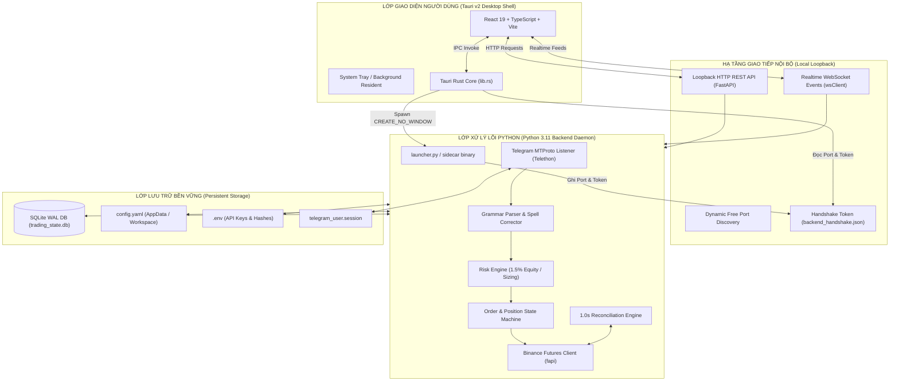
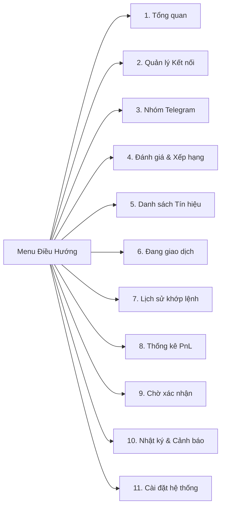
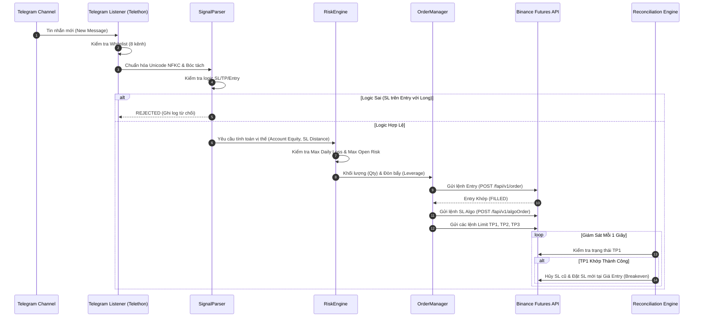

# TÀI LIỆU TOÀN DIỆN VỀ KIẾN TRÚC, TÍNH NĂNG VÀ VẬN HÀNH DỰ ÁN
## TELEGRAM BINANCE SIGNAL EXECUTOR (v2.0 PRO)

---

## 1. MỤC TIÊU VÀ BỐI CẢNH DỰ ÁN (EXECUTIVE SUMMARY)

**Telegram Binance Signal Executor** là hệ thống giao dịch tự động hóa cấp độ tổ chức (Institutional-Grade Trading Terminal) chạy trực tiếp trên máy tính người dùng (Desktop Application). 

Hệ thống giải quyết trọn vẹn bài toán:
1. **Lắng nghe trực tiếp từ Telegram cá nhân (MTProto Userbot):** Đọc tin nhắn thời gian thực từ các nhóm kín/kênh phân tích tín hiệu được ghim mà không cần quyền Admin Bot hay Webhook.
2. **Bóc tách thông minh (Grammar-Aware Natural Language Parser):** Tự động nhận diện cấu trúc lệnh (Long/Short, Entry, TP đa tầng, SL, Đòn bẩy) từ nhiều phong cách soạn tin khác nhau, tự sửa lỗi chính tả (`AKE- PROFIT`, `1) 0.018100`), nhận diện vung giá Range / Below.
3. **Quản trị rủi ro nghiêm ngặt (Risk Policy Engine):** Tự động tính toán khối lượng lệnh (Position Sizing) theo đúng tỷ lệ rủi ro tài khoản (mặc định 1.5% equity cho một kèo), khóa đòn bẩy tối đa 50x (riêng kênh Crypto Neon giới hạn cứng 10x), bắt buộc ký quỹ cô lập (`ISOLATED`).
4. **Thực thi và bảo vệ lệnh kép trên Binance Futures (USD-M):**
   - Đặt lệnh Entry (Limit hoặc Market).
   - Ngay khi khớp Entry, đặt ngay lệnh Cắt lỗ Stop-Market qua endpoint chuyên biệt `/fapi/v1/algoOrder` (tránh lỗi Binance Error -4120).
   - Đặt chốt lời từng phần (TP1 60%, TP2 25%, TP3 15%).
   - Tự động dời SL về Entry (Breakeven - Kèo Bất Tử) ngay khi chạm TP1.
5. **Giao diện Dashboard Quản Trị Trực Quan (Tauri v2 + React 19):** Giúp người dùng theo dõi tài sản, trạng thái kết nối, tín hiệu vào ra, lịch sử khớp lệnh sàn, đánh giá hiệu suất kênh và can thiệp thủ công khi cần.

---

## 2. KIẾN TRÚC TỔNG THỂ & HẠ TẦNG GIAO TIẾP (SYSTEM ARCHITECTURE)

Hệ thống được thiết kế theo mô hình **Desktop Hybrid Microservices**:

### Nguyên Lý Vận Hành Của Hạ Tầng:
1. **Khởi Động Không Xung Đột Cổng (Dynamic Port Discovery):** Backend không cố định cổng 8000. Khi khởi động, backend tự quét tìm cổng trống ngẫu nhiên (8000–8999), sinh một mã bí mật phiên `session_token` (UUID v4 ngẫu nhiên), và ghi vào file `backend_handshake.json` trong `%APPDATA%\telegram_binance_signal_executor`.
2. **Khởi Động Ngầm Hoàn Toàn (CREATE_NO_WINDOW):** Tiến trình backend được Tauri khởi chạy với cờ `0x08000000 (CREATE_NO_WINDOW)`, không xuất hiện cửa sổ CMD đen khó chịu trên màn hình Windows.
3. **Bảo Mật Cấp Cao (Loopback Security):** Toàn bộ API chỉ bind vào `127.0.0.1`. Tất cả yêu cầu HTTP và kết nối WebSocket bắt buộc mang header `X-Session-Token`. Bất kỳ yêu cầu nào từ bên ngoài hoặc thiếu token đều bị trả về lỗi `401 UNAUTHORIZED`.

---

## 3. CHI TIẾT TOÀN BỘ 11 MÀN HÌNH UI & MỐI LIÊN KẾT DỮ LIỆU

### 1. Màn Hình Tổng Quan (`OverviewPage.tsx`)
- **Mục tiêu:** Cung cấp góc nhìn toàn cảnh về sức khỏe hệ thống và tài sản trong một màn hình duy nhất.
- **Dữ liệu hiển thị:**
  - *Số dư Ký quỹ (Equity):* Lấy trực tiếp từ số dư tài khoản Binance USD-M Futures.
  - *PnL Hôm nay & 7 Ngày:* Tổng lãi/lỗ đã đóng thực tế.
  - *Thông lượng Telegram:* Tổng số tin nhắn đã nhận, số tin hợp lệ, số tin đang chờ duyệt.
  - *Vị thế Đang Mở:* Danh sách tóm tắt các coin bot đang nắm giữ kèm PnL chưa chốt (Unrealized PnL).
  - *Nhật ký gần nhất:* Các sự kiện vào lệnh, chốt lời, dời SL gần nhất.
- **Liên kết dữ liệu:** Gọi endpoint `/snapshot` và `/stats/pnl`.

### 2. Màn Hình Quản Lý Kết Nối (`ConnectionsPage.tsx`)
- **Mục tiêu:** Quản lý chứng thực và trạng thái hoạt động của Telegram và sàn Binance.
- **Thành phần Telegram:**
  - Quy trình đăng nhập MTProto chuẩn 3 bước: Nhập số điện thoại $\to$ Nhập mã OTP Telegram $\to$ Nhập mật khẩu 2FA (nếu có).
  - Hiển thị Tên tài khoản, ID, Trạng thái lắng nghe (`CONNECTED`, `CONNECTING`, `DISCONNECTED`).
- **Thành phần Binance Futures:**
  - Quản lý cấu hình khóa Testnet API Key / Secret và Live API Key / Secret.
  - Nút "Kiểm tra kết nối": Ping Binance server time, kiểm tra chế độ One-Way mode và đọc số dư USDT thực tế.
  - Nút "Đồng bộ số dư": Ép buộc cập nhật trạng thái ví ngay lập tức.
- **Liên kết dữ liệu:** `/telegram/profile`, `/telegram/credentials-status`, `/binance/credentials-status`, `/binance/test-connection`.

### 3. Màn Hình Nhóm & Kênh Telegram (`GroupsPage.tsx`)
- **Mục tiêu:** Quản lý danh sách hội thoại, thư mục Telegram (Chat Folders), lọc các kênh cho phép bot quét tín hiệu.
- **Tính năng nổi bật:**
  - Bộ lọc thông minh theo Thư mục: `Tất cả`, `Đã ghim`, `Đang theo dõi`, `Kèo trade`...
  - **Danh sách Whitelist 8 kênh chính thức:** Chỉ 8 kênh chất lượng cao nhất được kích hoạt.
  - Nút "Quét lịch sử 7d": Thu thập lại tin nhắn cũ của kênh để huấn luyện và kiểm thử.
  - Lưu cấu hình danh sách theo dõi trực tiếp xuống `config.yaml`.
- **Liên kết dữ liệu:** `/telegram/dialogs`, `/telegram/folders`, `/telegram/allowlist`.

### 4. Bảng Xếp Hạng & Đánh Giá Nhóm (`LeaderboardPage.tsx`)
- **Mục tiêu:** Đánh giá khách quan chất lượng tín hiệu từng kênh dựa trên kiểm thử thị trường thực tế (Backtest).
- **Thành phần cốt lõi:**
  - Phân loại Tier rõ ràng: **Tier S** ($\ge 75\%$), **Tier A** ($55\% - 74\%$), **Tier B** ($45\% - 54\%$), **Tier D** (Bị chặn/Rủi ro cao).
  - Cảnh báo trực diện các kênh scam hoặc kênh có tỷ lệ quét SL quá cao (Crypto Hunters 77.5% SL, ESTR 72.7% lỗi template).
  - Modal chi tiết: Khi bấm "Xem" từng kênh, hiển thị toàn bộ lịch sử kèo, tỷ lệ R:R, số lần chạm TP1, TP2, TP3.
- **Liên kết dữ liệu:** `/channels/leaderboard`, `/channels/{chat_id}/signals`.

### 5. Danh Sách Tín Hiệu (`SignalsPage.tsx`)
- **Mục tiêu:** Minh bạch toàn bộ quá trình thu thập và bóc tách tin nhắn từ Telegram.
- **Thành phần:**
  - Bảng tín hiệu với các trạng thái: `VALIDATED` (Hợp lệ), `REJECTED` (Bị từ chối), `NEEDS_REVIEW` (Cần người duyệt), `CLOSED` (Đã hoàn tất).
  - Nhấp vào từng dòng để mở ngăn kéo chi tiết (Drawer): So sánh văn bản gốc Telegram thô với kết quả bóc tách (Cặp coin, Chiều lệnh, Vùng Entry, Danh sách TP, Giá SL, Đòn bẩy).
  - Lý do từ chối rõ ràng: "SL nằm trên Entry ở lệnh LONG", "Thiếu SL", "Trùng coin đang có lệnh mở", "Tin quảng cáo VIP".
- **Liên kết dữ liệu:** `/signals`, `/signals/{signal_id}`.

### 6. Quản Lý Giao Dịch Đang Mở (`TradingPage.tsx`)
- **Mục tiêu:** Giám sát và điều khiển trực tiếp các vị thế đang chạy trên Binance Futures.
- **Thành phần:**
  - *Bảng Vị Thế:* Hiển thị Symbol, Chiều (LONG/SHORT), Đòn bẩy, Khối lượng, Giá vào (Entry Price), Giá hiện tại (Mark Price), Lãi/Lỗ chưa chốt (PnL & ROI%), Giá Cắt lỗ hiện tại, Mục tiêu Chốt lời tiếp theo.
  - *Trạng Thái Kèo Bất Tử (Breakeven):* Huy hiệu hiển thị rõ SL đã được dời về Entry an toàn hay chưa.
  - *Nút Đóng Khẩn Cấp (Panic Close):* Đóng vị thế bằng lệnh Market và hủy ngay toàn bộ lệnh chờ liên quan chỉ với 1 cú click.
  - *Bảng Lệnh Chờ:* Danh sách lệnh Limit Entry và lệnh điều kiện Algo SL/TP đang treo trên sổ lệnh sàn.
- **Liên kết dữ liệu:** `/trading/positions`, `/trading/orders`, `/trading/close-position`.

### 7. Lịch Sử Khớp Lệnh & PnL (`HistoryPage.tsx`)
- **Mục tiêu:** Báo cáo chi tiết từng lượt khớp lệnh thực tế trên sàn Binance Futures.
- **Thành phần:**
  - Bộ lọc thời gian: Hôm nay, 7 ngày qua, 30 ngày qua.
  - 4 Thẻ KPI: Realized PnL kỳ chọn, Tổng số lượt khớp sàn (Fills), Số vị thế đóng hoàn tất, Tỷ lệ thắng (Win Rate%).
  - Bảng nhật ký Fills chi tiết: Thời gian khớp, Mã lệnh sàn (Exchange Order ID), Cặp giao dịch, Chiều Mua/Bán, Giá khớp thực tế, Khối lượng, Phí giao dịch (Commission), Lãi/lỗ đã chốt (Realized PnL).
- **Liên kết dữ liệu:** `/trading/trades`, `/stats/pnl`.

### 8. Thống Kê & Phân Tích Hiệu Suất (`StatsPage.tsx`)
- **Mục tiêu:** Báo cáo kế toán minh bạch và phân tích thông lượng tin nhắn.
- **Thành phần:**
  - *Phần 1: Thông lượng Ingestion:* Số tin đã nhận $\to$ Đã chuẩn hóa NFKC $\to$ Nhận diện định dạng $\to$ Vượt qua kiểm tra logic $\to$ Số tin bị từ chối.
  - *Phần 2: Báo cáo Kế toán chuẩn:* Tách bạch rõ 4 đại lượng theo múi giờ `Asia/Ho_Chi_Minh` (00:00 - 24:00):
    $$\text{Net PnL} = \text{Realized PnL} - \text{Phí Giao Dịch (Commission)} - \text{Phí Funding}$$
- **Liên kết dữ liệu:** `/stats/pnl`, `/stats/telemetry`.

### 9. Chờ Xác Nhận / Human-In-The-Loop (`ReviewsPage.tsx`)
- **Mục tiêu:** Nơi người dùng can thiệp vào các tình huống ngoại lệ hoặc tín hiệu mâu thuẫn để bảo vệ tài khoản.
- **Các tình huống cần duyệt:**
  - Kèo bắn coin đang có vị thế mở (tránh đảo chiều ngoài ý muốn).
  - Khoảng cách SL quá xa (>30%) hoặc quá gần (<0.2%).
  - Tín hiệu thiếu tỷ lệ chia vốn TP.
- **Thao tác:** Người dùng có thể nhấn "Duyệt & Vào Lệnh" (kèm tùy chỉnh đòn bẩy/vốn) hoặc "Từ Chối Kèo".
- **Liên kết dữ liệu:** `/signals/pending-review`, `/signals/{id}/approve`, `/signals/{id}/reject`.

### 10. Nhật Ký & Cảnh Báo (`LogsPage.tsx`)
- **Mục tiêu:** Lưu trữ vết kiểm toán (Audit Trail) của hệ thống phục vụ rà soát sự cố.
- **Nội dung:** Ghi lại mọi hành động: Khởi động backend, nạp cấu hình, kết nối sàn, bóc tách tín hiệu, gửi lệnh Binance, lỗi mạng, dời SL.
- **Cấp độ:** `INFO`, `WARNING`, `CRITICAL`.
- **Liên kết dữ liệu:** `/alerts`, `/alerts/mark-all-read`.

### 11. Cài Đặt Hệ Thống & Quản Trị Rủi Ro (`SettingsPage.tsx`)
- **Mục tiêu:** Cấu hình toàn bộ tham số vận hành của Bot.
- **Các tham số:**
  - Chế độ vận hành: `TESTNET` (Trade thử nghiệm) vs `LIVE` (Tiền thật).
  - Khóa an toàn Live (`live_trading_enabled`): Ngăn chặn rủi ro vô tình bấm sang Live.
  - Rủi ro mỗi tín hiệu: Mặc định `1.5%` Equity.
  - Giới hạn lỗ tối đa ngày: Mặc định `5.0%` (Tự động kích hoạt Kill-Switch dừng giao dịch).
  - Đòn bẩy mặc định / Tối đa: Mặc định `20x`, Tối đa `50x`.
  - Tỷ lệ chốt lời TP1: Mặc định `60.0%` volume.
  - Cơ chế Kèo Bất Tử: Bật/Tắt tự động dời SL về Entry sau khi khớp TP1.
- **Liên kết dữ liệu:** `/settings` (GET/POST).

---

## 4. BACKEND LOGIC XỬ LÝ & VẬN HÀNH CHI TIẾT (CORE LOGIC)

### 1. Công thức Quản Trị Vốn (Position Sizing Formula):
Hệ thống sử dụng nguyên lý quản lý rủi ro chuẩn định chế tài chính:

$$\text{Rủi Ro Chấp Nhận (\$)} = \text{Tài Sản (Equity)} \times \text{Tỷ Lệ Rủi Ro (1.5\%)}$$

$$\text{Khoảng Cách Cắt Lỗ (\%)} = \frac{|\text{Giá Entry} - \text{Giá SL}|}{\text{Giá Entry}}$$

$$\text{Giá Trị Vị Thế (Notional \$)} = \frac{\text{Rủi Ro Chấp Nhận (\%)}}{\text{Khoảng Cách Cắt Lỗ (\%)}} = \frac{\text{Rủi Ro Chấp Nhận (\textit{\$})}}{\text{Khoảng Cách Cắt Lỗ (\%) \times \text{Giá Entry}}}$$

$$\text{Khối Lượng Coi (Quantity)} = \frac{\text{Giá Trị Vị Thế}}{\text{Giá Entry}}$$

$$\text{Ký Quỹ Bắt Buộc (Margin \$)} = \frac{\text{Giá Trị Vị Thế}}{\text{Đòn Bẩy (Leverage)}}$$

### 2. Xử Lý Vùng Entry (Range Entry) & Hyphen Take Profit:
- Kênh bắn Entry dạng vùng: `Entry: 0.1988 - 0.2010` $\to$ Áp dụng chính sách `BEST_PRICE`:
  - Lệnh LONG: Đặt Limit tại giá thấp nhất của vùng (`0.1988`) để tối ưu hóa vị thế.
  - Lệnh SHORT: Đặt Limit tại giá cao nhất của vùng (`0.2010`).
- Kênh bắn TP gạch nối: `0.002350-0.002250-0.002050` $\to$ Regex tự động bóc tách thành mảng 3 TP riêng biệt.

---

## 5. DANH SÁCH 8 KÊNH ĐANG HOẠT ĐỘNG & BẰNG CHỨNG LOẠI BỎ 3 KÊNH

Dựa trên dữ liệu thực tế thu thập từ **25,070 tin nhắn** trong vòng 6 tháng qua và đối chiếu biến động giá sàn Binance Futures 1h klines:

### Bảng Đánh Giá 8 Kênh Hoạt Động Chính Thức:

| STT | Tên Kênh Telegram | Chat ID | Tỉ Lệ Thắng (6 Tháng) | Đòn Bẩy Quy Định | Đặc Điểm Nhận Diện & Xử Lý |
| :---: | :--- | :---: | :---: | :---: | :--- |
| **1** | **CRYPTO LEOPARD'S** | `-1002052872813` | **84.6%** (33W-6L) | 20x - 50x | Kèo chất lượng cao, thường có 2 Entry và TP gạch nối. |
| **2** | **Crypto Neon** | `-1001370457350` | **80.0%** (28W-7L) | **Cố định 10x** | Kênh hay hô 50x mạo hiểm, Bot tự ép override về 10x an toàn. |
| **3** | **Crypto spider 🕷️ scalper** | `-1001895315984` | **78.9%** (30W-8L) | 20x - 50x | Kèo scalping nhanh, khớp TP1 rất nhanh, kích hoạt dời BE chuẩn. |
| **4** | **THE CRYPTO TRADER** | `-1001590450482` | **63.9%** (23W-13L) | 20x | R:R tốt (1:2.02). Bắn lệnh ngắn gọn, không spam quảng cáo. |
| **5** | **THE WOLF (CRYPTO)®** | `-1002007658025` | **56.4%** (22W-17L) | 20x | Kèo swing trung hạn, mục tiêu TP xa. |
| **6** | **Global Crypto Research** | `-1001161683441` | **55.0%** (22W-18L) | 20x | Tỷ lệ R:R cao (1:2.12), phân tích cơ bản kết hợp kỹ thuật. |
| **7** | **THE MASTER (CRYPTO)** | `-1002266035358` | **52.5%** (21W-19L) | 20x - 25x | Kèo dạng Entry Zone, thường kèm 3 TP và 1 SL rõ ràng. |
| **8** | **Crypto World Updates** | `-1001652601224` | **47.5%** (19W-21L) | 20x | Lệnh có tỷ lệ SL/TP cân bằng, tần suất ổn định. |

### Bằng Chứng Loại Bỏ Hoàn Toàn 3 Kênh Bị Chặn:
1. **Crypto Hunters (`-1002191067035`):**
   - *Lý do loại bỏ:* Tỷ lệ quét Stop Loss thực tế lên tới **77.5%** (chỉ thắng 9/40 kèo ngẫu nhiên). Kênh đặt SL quá sát cấu trúc nến khiến tài khoản liên tục bị cắn SL trước khi giá chạy.
2. **ESTR - EAT SLEEP TRADE REPEAT (`-1001656921849`):**
   - *Lý do loại bỏ:* Tỷ lệ lỗi logic SL/TP lên đến **72.7%** do người soạn tin copy nhầm template (Lệnh LONG nhưng SL đặt cao hơn giá Entry, hoặc TP đặt thấp hơn Entry).
3. **CRYPTO MONK (`-1001552004524`):**
   - *Lý do loại bỏ:* Tần suất tín hiệu thật quá thấp (chỉ 64 tin/3 tháng), nhưng có tới **17.2%** là tin dụ đăng ký VIP và tin mâu thuẫn SHORT/BUY trong cùng một tin.

---

## 6. NGUYÊN NHÂN GỐC RỄ CÁC LỖI ĐỒNG BỘ VÀ KẾ HOẠCH KHẮC PHỤC TRIỆT ĐỂ

Từ những quan sát trên hình ảnh thực tế của người dùng:

### Bug 1: Lệch Số Liệu PnL & Win Rate Giữa Thẻ KPI và Bảng Khớp Lệnh
- **Hiện tượng:** Màn hình *Lịch sử* hiển thị bảng 37 lượt khớp lệnh (Fills) với các khoản lãi thật `+27.44 USDT`, `+12.67 USDT`... nhưng thẻ KPI ở trên vẫn báo `Realized PnL: +$0.00` và `Tỷ lệ thắng: 0%`.
- **Nguyên nhân:** Thẻ KPI đọc từ endpoint `/stats/pnl`, vốn chỉ truy vấn bảng `daily_pnl` cục bộ (chưa có job chạy tự động tổng hợp), trong khi bảng lịch sử đọc trực tiếp từ Binance `/fapi/v1/userTrades`. Ngoài ra trong `StatsService`, các biến `win_count`, `loss_count` bị khởi tạo bằng 0 mà chưa được tính từ dữ liệu trades.
- **Khắc phục:** Cập nhật `/stats/pnl` tự động truy vấn dữ liệu khớp lệnh Binance thực tế để tính toán chính xác `Realized PnL`, `Commission`, `Net PnL` và `Win Rate%`, đồng bộ 100% giữa Dashboard, Thống kê và Lịch sử.

### Bug 2: Thông Báo "Dịch Vụ Backend Chưa Sẵn Sàng" / "Chưa Có API Key Testnet"
- **Hiện tượng:** Màn hình *Quản lý kết nối* hiển thị cảnh báo đỏ "Dịch vụ Backend chưa sẵn sàng", mặc dù ở thanh Header vẫn báo `Backend Online`.
- **Nguyên nhân:** Khi trang kết nối vừa mount, biến cờ `httpConnected` trong React Context khởi tạo là `false` trong 1-2 giây đầu. Hàm `fetchStatusAndProfile` lập tức gán `loginState = "BACKEND_UNAVAILABLE"` và không tự động thử lại khi backend đã sẵn sàng.
- **Khắc phục:** Bổ sung cơ chế auto-retry và đồng bộ trạng thái mềm (hiển thị trạng thái đang kiểm tra thay vì báo lỗi ngay lập tức).

### Bug 3: Dữ Liệu Bảng Xếp Hạng Vẫn Chứa Dữ Liệu Ảo 23 Kênh Cũ
- **Hiện tượng:** Leaderboard vẫn hiện 23 kênh, tôn vinh Crypto World Updates 86%, Crypto Hunters 70%, ESTR 83% (do đọc các tin khoe lãi của Admin scam trong timeline).
- **Khắc phục:** Đồng bộ hóa dữ liệu Leaderboard với file `data/channel_winrates_6_months.json`. Các kênh đã tắt (Crypto Hunters, ESTR, MONK) được gắn nhãn đỏ `[ĐÃ TẮT / CHẶN]` kèm lý do rủi ro.

### Bug 4: Văn Bản Ghi "22 Nhóm Ghim" Thay Vì 8 Kênh
- **Hiện tượng:** Tại nhật ký và màn hình tổng quan vẫn hiện chuỗi chữ "Đang giám sát 22 nhóm ghim".
- **Khắc phục:** Chuyển toàn bộ các chuỗi cứng thành đại lượng động: `f"Đang giám sát {len(allowed_chat_ids)} nhóm ghim đã duyệt"`.

### Bug 5: Installer và File Thực Thi Chưa Được Recompile Đồng Bộ
- **Hiện tượng:** Khi chạy `launch_app.bat`, file `app.exe` và `backend.exe` chưa được nạp các bản vá mới nhất của parser và logic kết nối.
- **Khắc phục:** Thực hiện chu trình Recompile toàn diện từ PyInstaller đến Tauri Installer NSIS.

### Bug 6: Single-entry Target Parsing ("Entry Targets: 1) 0.1160")
- **Hiện tượng:** Khi admin đăng tín hiệu chỉ có 1 mức entry dưới dạng `Entry Targets:\n 1) ➡️ 0.1160`, parser báo lỗi `Không có mức giá entry hợp lệ`.
- **Nguyên nhân:** Regex và logic trong `signal_parser.py` đặt điều kiện `len(sec_nums) >= 2`, vô tình loại bỏ các tín hiệu chỉ có 1 target entry.
- **Khắc phục:** Bổ sung xử lý nhánh `len(sec_nums) == 1` và cập nhật regex `m_explicit_numbered` cùng `m_single` để nhận diện trọn vẹn cả 1 entry lẫn nhiều entry.

### Bug 7: Lỡ Điểm Vào Lệnh Khi Giá Thị Trường Tốt Hơn Giá Admin Cho
- **Hiện tượng:** Khi tín hiệu gửi đến nhưng giá thị trường đã đi xuống thấp hơn entry Long (hoặc cao hơn entry Short), lệnh Limit cũ không khớp được hoặc bị bỏ lỡ điểm vào lệnh đẹp.
- **Khắc phục:** Tích hợp bộ kiểm tra giá thị trường thời gian thực (Mark Price / Ticker). Nếu giá thị trường có lợi hơn hoặc bằng entry admin, hệ thống tự động điều chỉnh đặt lệnh đón ngay lập tức với đòn bẩy và khối lượng bảo toàn rủi ro.

### Bug 8: Rate-Limiter Binance Quá Chặt Gây Chậm Lệnh
- **Hiện tượng:** Khi hệ thống thực hiện nhiều tác vụ đồng bộ snapshot, tài khoản hoặc lịch sử lệnh, các lệnh khẩn cấp bị xếp hàng chờ qua giới hạn 1200 weight/phút.
- **Khắc phục:** Nâng ngưỡng giới hạn an toàn lên 2000 weight/phút (chuẩn Binance Futures cho IP thông thường), đồng thời tách luồng fast-track ưu tiên cao nhất cho endpoint đặt lệnh `/fapi/v1/order` và `/fapi/v1/algoOrder`.

### Bug 9: Trùng Lặp Lệnh Cắt Lỗ (Duplicate Stop Loss) Khi Reconcile
- **Hiện tượng:** Khi backend khởi động lại, engine quét đối chiếu sàn phát hiện vị thế nhưng tạo thêm một lệnh Stop Loss mới trong khi lệnh cũ vẫn còn trên sàn.
- **Khắc phục:** Nâng cấp `ReconciliationEngine` để kiểm tra danh sách `openOrders` trên Binance trước khi đặt lệnh bảo vệ, hủy lệnh mồ côi và bảo đảm duy nhất 1 lệnh Stop Loss gắn với vị thế.

### Feature 10: Tự Động Phân Bổ Multi-TP (60% / 26% / 14%) & Kích Hoạt Hòa Vốn (Breakeven)
- Phân bổ thông minh khối lượng chốt lời: TP1 chốt 60% bảo toàn lãi lớn nhất, TP2 chốt 26%, TP3 chốt 14%.
- Ngay khi sàn khớp lệnh TP1, hệ thống tự động dời Stop Loss về giá hòa vốn (kèm bù trượt giá và phí sàn), đưa vị thế về trạng thái "Kèo Bất Tử" (Risk-Free).

### Feature 11: Đóng Gói Bộ Cài Đặt Chuẩn NSIS v1.1.7
- Đóng gói file cài đặt tự động `telegram-binance-signal-executor_1.1.7_x64-setup.exe` trong `target/release/bundle/nsis` và thư mục gốc của dự án.
- Tự động tích hợp biểu tượng desktop shortcut, dọn dẹp tiến trình cũ và cấu hình đường dẫn dữ liệu `%APPDATA%`.

---

## 7. QUY TRÌNH KIỂM CHỨNG & VẬN HÀNH CHUẨN (STANDARD OPERATING PROCEDURE)

1. **Khởi Động Ứng Dụng:** Chạy shortcut trên Desktop hoặc `launch_app.bat`. Cửa sổ Dashboard sẽ mở lên với trạng thái:
   - `BINANCE LIVE` hoặc `TESTNET`.
   - `Giao dịch Live: ĐANG BẬT`.
   - `Entry: ĐANG NHẬN` (xanh sẵn sàng).
2. **Kiểm Tra Kết Nối:**
   - Vào menu *Kết nối*: Đảm bảo Telegram báo `ĐÃ KẾT NỐI` và Binance báo `ĐÃ LIÊN KẾT`.
3. **Giám Sát Tín Hiệu:**
   - Khi 1 trong 8 kênh bắn tín hiệu, tin nhắn xuất hiện trong *Tín hiệu* với trạng thái `VALIDATED`.
   - Lệnh tự động vào sàn và hiển thị tại *Đang giao dịch*.
   - Khi TP1 khớp, trạng thái vị thế chuyển thành `BẢO VỆ (BREAKEVEN)`.
4. **Xem Báo Cáo:**
   - Màn hình *Lịch sử* và *Thống kê* cập nhật PnL từng phút, khớp từng xu phí sàn.

