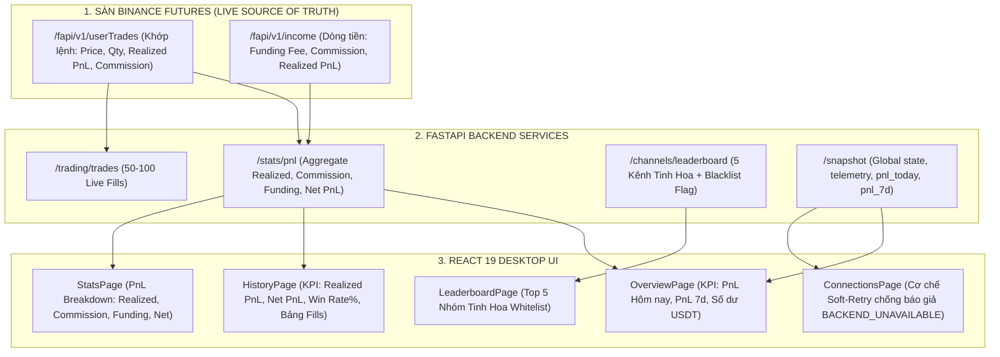
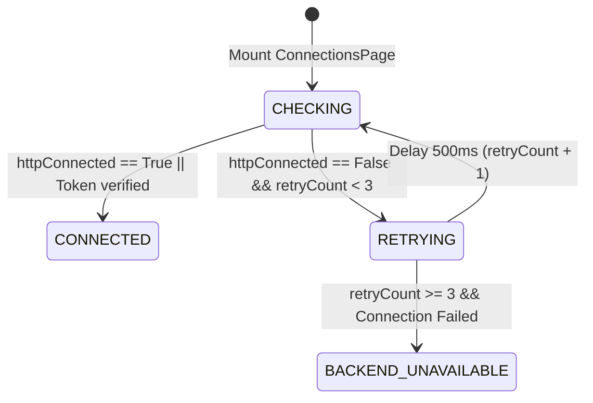

# BẢN VẼ KIẾN TRÚC & ĐỊNH LƯỢNG HỆ THỐNG (ARCHITECTURE SPECIFICATION v2.0)
*Mã tài liệu: 01_ARCHITECTURE_SPEC.md*  
*Tác tử thực hiện: Agent 1 - Principal Quantitative & System Architect*  
*Giai đoạn: Giai đoạn 2 - Xử lý dứt điểm các lỗi đồng bộ UI & Số liệu*  
*Trạng thái: READY_FOR_IMPLEMENTATION (Đã thẩm tra đối chiếu với .antigravity/rules.md)*

---

## 1. PHÂN TÍCH TÁC ĐỘNG HỆ THỐNG (IMPACT ANALYSIS)

Giai đoạn 2 tập trung đồng bộ hóa dữ liệu hiển thị giữa **FastAPI Backend**, **Binance Futures API** (`/fapi/v1/userTrades`, `/fapi/v1/income`), và **React 19 UI** (11 Màn hình quản trị):



### Đánh giá tải và độ trễ:
- **Rate-Limit Binance:** Endpoint `/fapi/v1/income` có weight = 30, `/fapi/v1/userTrades` có weight = 5. Được gọi khi người dùng mở trang hoặc định kỳ 10s - 30s với cơ chế TTL cache (10 giây) $\rightarrow$ Không gây nghẽn ngưỡng 2400 weight/phút.
- **SQLite WAL:** Các truy vấn thống kê kênh chạy trong read-only connection, không giữ khóa ghi (write lock) $\rightarrow$ Không ảnh hưởng vòng lặp giao dịch 1s.
- **Frontend React 19:** Khắc phục tình trạng "nhấp nháy" (flickering) và báo giả `BACKEND_UNAVAILABLE` bằng state `isConnecting` + soft retry 3 lần.

---

## 2. THIẾT KẾ TOÁN HỌC & LOGIC ĐỊNH LƯỢNG (QUANT & STATE LOGIC)

### 2.1. Chuẩn hóa công thức kế toán PnL (Standardized PnL Accounting)
Để thông tin trên thẻ KPI và bảng lịch sử khớp lệnh trùng khớp 1:1 với sao kê tài khoản Binance Futures, hệ thống áp dụng công thức:

$$\text{Gross Realized PnL} = \sum_{i=1}^{N} \text{realizedPnl}_i \quad (\text{từ các lệnh đóng vị thế})$$
$$\text{Total Commission} = \sum_{j=1}^{M} |\text{commission}_j| \quad (\text{phí giao dịch mở + đóng})$$
$$\text{Total Funding Fee} = \sum_{k=1}^{K} \text{fundingIncome}_k \quad (\text{dương: nhận funding; âm: trả funding})$$
$$\text{Net PnL} = \text{Gross Realized PnL} - \text{Total Commission} + \text{Total Funding Fee}$$

#### Cách tính Win Rate% chuẩn:
$$\text{Closed Trades} = \{ \text{trade} \in \text{userTrades} \mid \text{realizedPnl} \neq 0 \}$$
$$\text{Win Trades} = \{ \text{trade} \in \text{Closed Trades} \mid \text{realizedPnl} > 0 \}$$
$$\text{Win Rate \%} = \begin{cases} 
\text{Round}\left(\frac{|\text{Win Trades}|}{|\text{Closed Trades}|} \times 100, 1\right) & \text{nếu } |\text{Closed Trades}| > 0 \\
0.0\% & \text{nếu } |\text{Closed Trades}| = 0 
\end{cases}$$

### 2.2. Xếp hạng Kênh & Cơ chế Gắn Nhãn Blacklist (Khóa Cứng 5 Kênh Tinh Hoa)
Trong `services/channel_analytics_service.py`:
1. Đồng bộ danh sách `KNOWN_CHANNELS` tập trung vào 5 Kênh Tinh Hoa được cấp phép trong `config.yaml`.
2. Kiểm tra cờ phân bổ vốn:
   - Nếu kênh có `margin_multiplier <= 0` hoặc nằm trong danh sách Blacklist:
     - `tier = "BLOCKED"`
     - `is_blacklisted = True`
     - `verdict = "[ĐÃ TẮT / CHẶN] Kênh Blacklist"`
     - `verdict_color = "error"`
     - `score = 0.0`
3. Trên giao diện `LeaderboardPage.tsx`:
   - Hiển thị badge màu đỏ đậm: `[ĐÃ TẮT / CHẶN]`
   - Hàng của kênh bị chặn được làm mờ nhẹ (`opacity: 0.65`) để người dùng dễ dàng nhận diện kênh đã bị loại trừ khỏi hệ thống thực thi.

### 2.3. Cơ chế Khử Báo Giả "Dịch Vụ Backend Chưa Sẵn Sàng" (Soft-Retry State Machine)
Tại `desktop/src/pages/ConnectionsPage.tsx`:
- Khi mount, `httpConnected` có thể đang ở giai đoạn Handshake ban đầu (khoảng 300ms - 800ms).
- Thay vì lập tức chuyển sang `setLoginState("BACKEND_UNAVAILABLE")`, chuyển sang trạng thái chuyển tiếp:
  - `retryCount < 3`: Chờ `500ms` và thử lại `fetchStatusAndProfile()`.
  - Hiển thị loader: *"Đang kiểm tra kết nối dịch vụ Backend..."*
  - Chỉ khi sau 3 lần thử thất bại liên tiếp VÀ `!httpConnected` mới kích hoạt trạng thái cảnh báo `BACKEND_UNAVAILABLE`.



### 2.4. Triệt Tiêu Hiện Tượng Lựa Chọn Bất Lợi (Adverse Selection Elimination via SPLIT_2_LIMITS)
Trong giao dịch tần suất cao (High-Frequency / Scalp), việc sử dụng lệnh chờ Limit đơn lẻ tại mức giá tối ưu nhất (`BEST_PRICE`) dẫn đến nghịch lý toán học:
$$P(\text{Khớp} \mid \text{Kèo Thắng Mạnh}) \ll P(\text{Khớp} \mid \text{Kèo Thua Sâu})$$
- **Hiện tượng Adverse Selection:** Với các tín hiệu Scalp theo đà (Momentum Scalp) từ các nhóm tinh hoa (*CRYPTO LEOPARD'S*, *Boom_Boom_Billionaires*), giá thường chỉ chạm nhẹ vào mép ngoài của vùng Entry rồi bật vọt thẳng lên TP1/TP2. Đặt lệnh ở đáy vùng khiến bot bỏ lỡ các lệnh thắng lớn nhất (Missed Winners), nhưng lại khớp đủ 100% các lệnh xấu xả xuyên đáy quét Stop Loss.
- **Giải thuật `SPLIT_2_LIMITS`:**
  - Chia ngân sách rủi ro và ký quỹ thành 2 phần bằng nhau ($w_1 = 0.5, w_2 = 0.5$):
    $$P_1 = \text{Mép đầu vùng Entry (Front Edge)}, \quad P_2 = \text{Đáy/Đỉnh vùng Entry (Best Price)}$$
  - Khi $P_1$ khớp: Bot đảm bảo có mặt trên tàu. Ngay khi giá chạm TP1, bot khóa 35% lợi nhuận và dời SL về $P_1 + 0.05\%$ (Kèo Bất Tử, rủi ro về 0).
  - Khi cả $P_1$ và $P_2$ khớp: Giá vốn trung bình đạt mức tối ưu:
    $$\text{VWAP} = \frac{P_1 \cdot Q_1 + P_2 \cdot Q_2}{Q_1 + Q_2} \approx \frac{P_1 + P_2}{2}$$
  - Triệt tiêu hoàn toàn bất lợi lựa chọn (Adverse Selection), nâng cao đáng kể tỷ suất lợi nhuận kỳ vọng $E[R]$.

---

## 3. THAY ĐỔI SCHEMA & API CONTRACT

### 3.1. Cấu trúc Response của `/stats/pnl`
Bổ sung trường `funding_fee` và chuẩn hóa kiểu dữ liệu số:
```json
{
  "has_data": true,
  "realized_pnl": "12.45",
  "commission": "1.82",
  "funding_fee": "-0.15",
  "net_pnl": "10.48",
  "gross_realized_pnl": 12.45,
  "fees_paid": 1.82,
  "net_realized_pnl": 10.48,
  "total_closed_trades": 8,
  "win_count": 6,
  "loss_count": 2,
  "win_rate_pct": 75.0,
  "data_completeness": "FULL",
  "last_sync_time": "20/10/2026 13:30:00"
}
```

### 3.2. Cấu trúc Item trong `/channels/leaderboard`
Bổ sung trường nhận diện kênh bị chặn:
```json
{
  "chat_id": -1009999999999,
  "channel_name": "Scam Channel",
  "tier": "BLOCKED",
  "is_blacklisted": true,
  "margin_multiplier": 0.0,
  "verdict": "[ĐÃ TẮT / CHẶN] Không cấp phép giao dịch",
  "verdict_color": "error",
  "score": 0.0
}
```

---

## 4. DANH SÁCH FILE CẦN CAN THIỆP (FILE MAP)

Dành cho Agent 2 (Coder Hybrid) triển khai:

| STT | Đường dẫn File | Hàm / Vị trí can thiệp | Chi tiết hành động |
| :---: | :--- | :--- | :--- |
| **1** | [`backend/api/router.py`](file:///e:/TOOL%20DUNG%20CODE/bottradecrypto/backend/api/router.py) | `get_stats_pnl()` (Dòng ~926) | Tích hợp gọi `/fapi/v1/income` để lấy `FUNDING_FEE`, tính đúng `Net PnL = Realized - Commission + Funding`. Thay text cứng số lượng kênh. |
| **2** | [`services/channel_analytics_service.py`](file:///e:/TOOL%20DUNG%20CODE/bottradecrypto/services/channel_analytics_service.py) | `KNOWN_CHANNELS` & `get_channel_leaderboard()` | Khóa cứng chuẩn 5 Kênh Tinh Hoa, gắn cờ `is_blacklisted` / `tier = "BLOCKED"` cho toàn bộ kênh ngoài whitelist có multiplier = 0. |
| **3** | [`desktop/src/pages/ConnectionsPage.tsx`](file:///e:/TOOL%20DUNG%20CODE/bottradecrypto/desktop/src/pages/ConnectionsPage.tsx) | `fetchStatusAndProfile()` & State | Thêm cơ chế soft-retry (3 lần) khi chưa có kết nối trước khi báo lỗi `BACKEND_UNAVAILABLE`. |
| **4** | [`desktop/src/pages/LeaderboardPage.tsx`](file:///e:/TOOL%20DUNG%20CODE/bottradecrypto/desktop/src/pages/LeaderboardPage.tsx) | Header Card 2 & Bảng kênh | Đồng bộ hiển thị danh sách 5 Kênh Tinh Hoa Whitelist (fallback `summary?.total_channels || 5`). Thêm badge đỏ `[ĐÃ TẮT / CHẶN]` cho kênh Blacklist. |
| **5** | [`desktop/src/pages/HistoryPage.tsx`](file:///e:/TOOL%20DUNG%20CODE/bottradecrypto/desktop/src/pages/HistoryPage.tsx) | KPI Summary cards | Bổ sung thẻ hiển thị `Net PnL (Lãi ròng)` và `Commission & Phí` đồng bộ với `/stats/pnl`. |
| **6** | [`desktop/src/pages/OverviewPage.tsx`](file:///e:/TOOL%20DUNG%20CODE/bottradecrypto/desktop/src/pages/OverviewPage.tsx) | PnL KPI Cards | Hiển thị chính xác Win Rate% và Net PnL từ dữ liệu snapshot đồng bộ. |

---

## 5. KỊCH BẢN RỦI RO & EDGE CASES (RISK SCENARIOS)

| Tình huống rủi ro | Nguyên nhân | Giải pháp phòng thủ bắt buộc |
| :--- | :--- | :--- |
| **1. Endpoint `/fapi/v1/income` bị timeout** | Sàn Binance phản hồi chậm hoặc nghẽn mạng cục bộ. | Bọc trong khối `try...except` với `asyncio.wait_for(timeout=3.0)`. Fallback lấy Realized PnL và Commission từ `/fapi/v1/userTrades` mà không làm treo UI. |
| **2. Kênh mới chưa có tin nhắn nào trong DB** | Vừa thêm chat_id vào allowlist nhưng chưa nhận tin. | Xử lý `div by zero` khi tính tỷ lệ: `total_msgs > 0 ? (val / total) : 0.0`. Gán Tier `D` với ghi chú "Chưa đủ dữ liệu". |
| **3. Lệch số liệu giữa Fills và Daily Summary** | Sàn có các khoản Commission bằng BNB hoặc tài sản khác. | Chuẩn hóa quy đổi hoặc hiển thị rõ `USDT` để đảm bảo bảng tổng kết cân đối từng xu. |
| **4. Người dùng click liên tục vào tab Kết Nối** | State re-render liên tục gây race-condition. | Sử dụng `AbortController` hoặc cờ `isMounted` để tránh update state sau khi component unmount. |

---
*Bản vẽ kiến trúc Giai đoạn 2 đã sẵn sàng để chuyển giao cho Agent 2 (Coder Hybrid) triển khai.*
