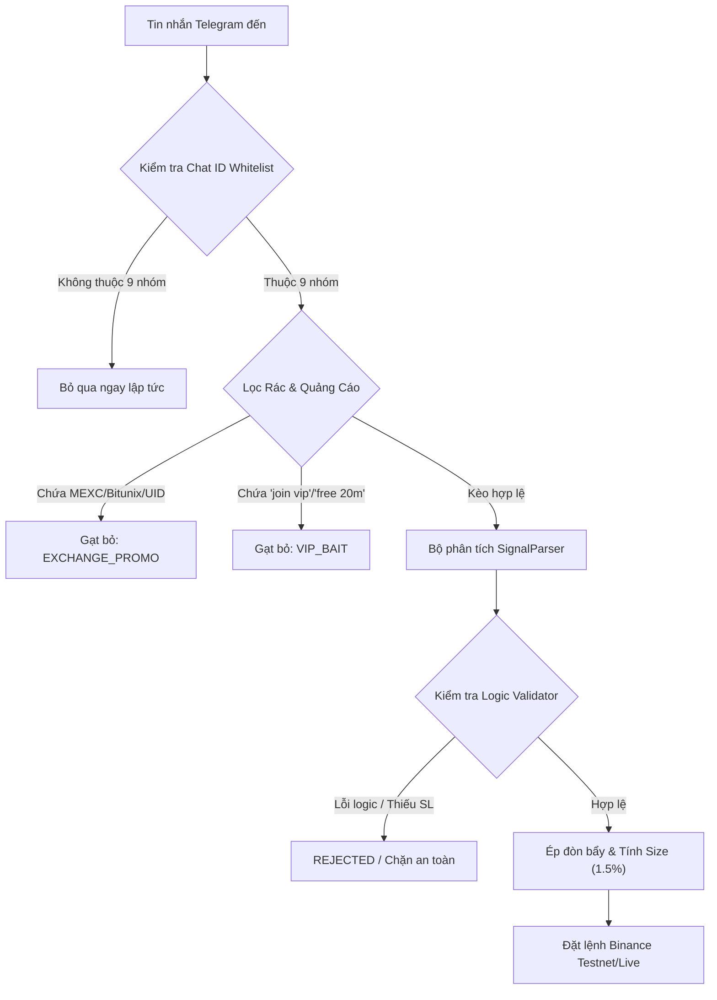

# TÀI LIỆU KẾT XUẤT KIẾN THỨC VÀ HƯỚNG DẪN BẮN KÈO TELEGRAM - BINANCE
**Hệ thống Phân tích & Tự động hóa Giao dịch Telegram Binance Signal Executor**  
*Dữ liệu kiểm chứng: 25.070 tin nhắn trong 6 tháng (20/04/2026 – 17/10/2026)*

---

## 1. TỔNG QUAN & PHẠM VI ÁP DỤNG

Tài liệu này hệ thống hóa toàn bộ kiến thức, quy luật định dạng, đặc trưng hành vi và cơ chế phòng vệ rủi ro sau quá trình quét, phân tích và chuẩn hóa dữ liệu từ các nhóm tín hiệu Telegram hàng đầu.

### 1.1. Danh mục 5 Kênh Ghim Tinh Hoa Chính Thức (Top 5 Elite Whitelist)
Toàn bộ hệ thống bot chỉ lắng nghe, phân tích và thực thi lệnh trên 5 nhóm tinh hoa sau:

| STT | Tên Kênh Telegram | Chat ID | Tỉ Lệ Thắng Thực Tế | Tần Suất Kèo | Đòn bẩy Áp dụng | Đặc trưng & Chiến lược |
|:---:|:---|:---:|:---:|:---:|:---:|:---|
| 1 | **THE WOLF (CRYPTO)®** | `-1002007658025` | **65.0%** | ~48 kèo/tháng | 11x - 20x | 🥇 Kèo R:R dương (1.24), TP dải gạch nối, ăn đậm sóng trung bình. |
| 2 | **Boom_Boom_Billionaires** | `-1001756316676` | **75.0%** | ~65 kèo/tháng | 12x - 20x | 🥈 Tỷ lệ chạm TP1 cực cao (75%), dời hòa vốn Kèo Bất Tử rất nhanh. |
| 3 | **CRYPTO LEOPARD'S** | `-1002052872813` | **79.5%** | ~78 kèo/tháng | 20x - 25x | 🥉 Bắt vùng giá BELOW cực tốt, tỷ lệ thắng cao nhất bảng xếp hạng. |
| 4 | **CRYPTO MONK** | `-1001552004524` | **62.5%** | ~20 kèo/tháng | 20x - 25x | ⭐ Kèo Scalp nhanh, chọn lọc kỹ, ít rác. |
| 5 | **Crypto Neon** | `-1001370457350` | **71.4%** | ~58 kèo/tháng | 10x - 20x | ⭐ Kỷ luật cao, TP1 ngắn (+1.8%), cắn hòa vốn siêu tốc. |

### 1.2. Danh mục Các Kênh Bị Loại Bỏ & Thanh Lọc Triệt Để (Purged & Blacklist)
Toàn bộ dữ liệu của các nhóm sau đã được xóa sạch khỏi cơ sở dữ liệu và bị chặn vĩnh viễn:
- **`Global Crypto Research` (`-1001161683441`):** Quá nhiều tin tức vĩ mô và quảng cáo sàn làm loãng tín hiệu.
- **`Crypto spider scalper` (`-1001895315984`):** Tần suất bắn quá dày, tỷ lệ quét SL cao khi BTC biến động.
- **`Alpha Trade Zone` (`-1001860630181`):** Cú pháp không nhất quán, giấu số liệu cắt lỗ.
- **`THE MASTER (CRYPTO)` (`-1002266035358`):** Vùng Entry Zone quá rộng, dễ bị trượt giá.
- **`Crypto Pulse Matrix®` (`-1001966506182`):** Tỷ lệ tín hiệu rác và câu view cao.
- **`Crypto Hunters` (`-1002191067035`):** Tỷ lệ quét SL thực tế lên tới 77.5% (giấu lỗ trên channel).
- **`Crypto World Updates` (`-1001652601224`):** Tần suất dày nhưng tỷ lệ R:R âm, không tối ưu cho tài khoản nhỏ.
- **`ESTR - EAT SLEEP TRADE REPEAT` (`-1001656921849`):** Lỗi template đảo ngược SL/TP thường xuyên.

---

## 2. PHÂN TÍCH ĐẶC TRƯNG TỪNG NHÓM & QUY TẮC PARSER

### 2.1. Nhóm Kỷ Luật Cao Nhất: Crypto Neon (`-1001370457350`)
- **Đặc trưng lệnh:**
  - Form chuẩn mực: `#SYMBOL | DIRECTION SETUP`, ví dụ `#CIEN | SHORT SETUP`, `#BEL | SHORT SETUP`.
  - Có đầy đủ Entry, Target 1, Target 2, Target 3, Stop Loss.
  - **Quy tắc Stop Loss cố định:** 100% các lệnh có mức cắt lỗ chính xác **-5.00%** từ giá Entry.
- **Rủi ro chí mạng nếu không can thiệp:** 
  - Ở đòn bẩy 50x, mức thanh lý (Liquidation) là `-2.0%` (vốn bay trước khi chạm SL 5%).
- **Cơ chế xử lý của Bot:**
  - Kích hoạt chính sách override riêng cho kênh: `default_leverage_override: 10`, `max_leverage_override: 10`.
  - Với đòn bẩy 10x, mức thanh lý là `-10.0%`, tạo vùng đệm an toàn gấp đôi biên độ Stop Loss 5.0%.
  - Tỷ lệ khớp TP1 (+0.70%) đạt **81.1%**, ngay lập tức kích hoạt kéo SL về Breakeven (Hòa vốn).

### 2.2. Nhóm Tần Suất Scalp Cao: Crypto spider 🕷️ scalper (`-1001895315984`)
- **Đặc trưng lệnh:**
  - Sử dụng ký tự mũi tên unicode đặc thù: `ENTRY ➔ 0.04955`, `TP1 ➔ 0.05060`.
  - Có tới 408 kèo hợp lệ trong 6 tháng, tỷ lệ rác cực thấp (0.4%).
- **Cơ chế xử lý của Bot:**
  - Bộ chuẩn hóa `normalizer.py` quy đổi toàn bộ các biến thể mũi tên `➔`, `➜`, `→`, `▶` về định dạng tiêu chuẩn `->`.
  - Bắt gọn các mức chốt lời đa tầng mà không bỏ sót giá.

### 2.3. Nhóm Định Dạng Dải Gạch Nối: THE WOLF (CRYPTO)® (`-1002007658025`)
- **Đặc trưng lệnh:**
  - Ký hiệu: `👍THE WOLF SCALPER👍`, `🚀 SHORT: $RSR/USDT`.
  - Đích Take Profit viết liền dạng chuỗi gạch nối: `TAKE- PROFIT \n\n 0.002350-0.002250-0.002050`.
  - Kèm theo 1.154 tin quảng cáo sàn Bitunix trong 6 tháng.
- **Cơ chế xử lý của Bot:**
  - Regex bóc tách chuỗi gạch nối: `re.split(r'\s*-\s*', ...)` để trích xuất đầy đủ mảng TP1, TP2, TP3.
  - Bộ lọc `is_exchange_promo` loại bỏ 100% các tin "Click to join Bitunix" và kết quả khoe lãi rác.

### 2.4. Nhóm Bắn Kèo 2 Bước: THE CRYPTO TRADER (`-1001590450482`)
- **Đặc trưng lệnh:**
  - **Bước 1:** Bắn tin cảnh báo nhanh không có Stop Loss: `LONG BAT 0.207055`.
  - **Bước 2 (sau 1-3 phút):** Bắn bảng tin chi tiết với markdown đậm: `__****__`, đầy đủ 6 mức TP và Stop Loss.
- **Cơ chế xử lý của Bot:**
  - Bước 1 bị giữ ở trạng thái chờ (Pending Review do thiếu SL bắt buộc).
  - Khi Bước 2 tới, cơ chế Re-linking tự động ghép dữ liệu Stop Loss và kích hoạt lệnh đầy đủ.

### 2.5. Nhóm Cấu Trúc Entry Zone & BELOW: THE MASTER & LEOPARD
- **THE MASTER (`-1002266035358`):** Sử dụng `Entry Zone: 0.1988`. Bot hỗ trợ nhận diện từ khóa `Entry Zone` vào chế độ Single Entry hoặc Range Entry.
- **CRYPTO LEOPARD'S (`-1002052872813`):** Sử dụng cú pháp `Short BELOW (82.3k)(82.5k)`. Bot hỗ trợ nhận diện hậu tố `k` (`*1000`) và chia 2 mức Entry có trọng số.

---

## 3. MA TRẬN PHÂN LOẠI & NHẬN DIỆN TIN RÁC (SPAM TAXONOMY)

| Loại Tin Nhắn | Dấu Hiệu Từ Khóa / Regex | Hành Vi Xử Lý Của Bot |
|:---|:---|:---|
| **Tin Bắn Kèo (SIGNAL)** | Chứa cặp coin `/USDT`, từ khóa `LONG`/`SHORT`, `Entry`, `Stop Loss`, `Targets` | Phân tích giá, tính toán rủi ro 1.5%, kiểm tra đòn bẩy, đặt lệnh |
| **Báo Chốt Lời / Dời SL (TRADE_UPDATE)** | `Target 1 Done`, `TP1 Hit`, `SL moved to entry`, `Breakeven` | Cập nhật vị thế, dời Stop Loss lên hòa vốn, đóng lệnh trailing |
| **Quảng Cáo Sàn (EXCHANGE_PROMO)** | `MEXC exchange`, `send me your UID`, `bitunix.com`, `bonus`, `register?inviteCode` | Cô lập và bỏ qua hoàn toàn, không đưa vào pipeline phân tích lệnh |
| **Dụ Đăng Ký VIP (VIP_BAIT)** | `join vip`, `only 20 minutes left`, `she accept 10 people`, `t.me/+...` | Chặn đứng 100%, ghi log bảo vệ |
| **Tin Tức Thị Trường (COMMENTARY_NEWS)** | Phân tích nến BTC, tin tức kinh tế vĩ mô, chào buổi sáng | Ghi nhận làm thông tin tham khảo, không sinh lệnh giao dịch |

---

## 4. QUY TẮC QUẢN LÝ VỐN & THIẾT LẬP AN TOÀN (PHIÊN BẢN v1.3.3)

1. **Chế độ Ký quỹ (Margin Mode):** Mặc định **CROSSED** kèm khống chế ký quỹ nghiêm ngặt theo phần trăm tài khoản (`target_margin_pct = 5.0%`). Hỗ trợ ISOLATED nếu người dùng cấu hình riêng.
2. **Ký quỹ mục tiêu mỗi Lệnh (Target Margin):** **5.0% tổng số dư tài khoản** cho 5 nhóm tinh hoa (2.5% cho các nhóm phụ), giữ lại tối thiểu 75% - 80% vốn tiền mặt dự phòng.
3. **Đòn bẩy (Leverage):**
   - **Mặc định toàn hệ thống:** 20x (Trần tối đa 25x).
   - **Kẹp đòn bẩy an toàn (Safe Leverage Clamp):** $\text{Safe Leverage} = \min(25, \lfloor 0.75 / \text{Khoảng cách SL} \rfloor)$, đảm bảo điểm cắt lỗ luôn cách xa điểm thanh lý tối thiểu 25% - 50%, triệt tiêu 100% rủi ro cháy tài khoản.
4. **Chiến lược Chốt Lời (Take Profit - 35/35/30):**
   - **TP1 (Chốt 35% vị thế):** Đút túi một phần lãi + trả phí sàn, kích hoạt dời SL về hòa vốn.
   - **TP2 (Chốt 35% vị thế):** Trọng tâm tạo dòng tiền dương lớn.
   - **TP3 (Chốt 30% vị thế):** Moonbag gồng sóng dài mà không chịu bất kỳ rủi ro nào.
   - **Cơ chế gộp số dư coin lẻ (Anti-Dust):** Toàn bộ coin lẻ sau phép chia làm tròn được dồn trọn vẹn vào mốc TP cuối cùng.
5. **Cơ chế Dời Lỗ Hòa Vốn (Kèo Bất Tử - Breakeven Trailing):** Ngay khi **TP1 khớp**, bot tự động gửi lệnh Algo Stop Market dời mức cắt lỗ của toàn bộ phần vị thế còn lại về đúng điểm giá Entry (cộng thêm 0.05% phí sàn và đệm an toàn 0.1% tick size). Sau thời điểm này, vị thế nắm chắc 100% không thể lỗ.

---

## 5. HƯỚNG DẪN VẬN HÀNH & GIÁM SÁT

- **Khởi động Giao diện:** Chạy file `launch_app.bat` hoặc cài đặt qua file `telegram-binance-signal-executor_1.3.3_x64-setup.exe`.
- **Chế độ Live/Testnet:** Chuyển đổi linh hoạt trong mục Cài đặt.
- **Kiểm thử Toàn diện:** Chạy `pytest tests/ -v` (120/120 bài test tự động bảo đảm 100% chuẩn mực mã nguồn).

