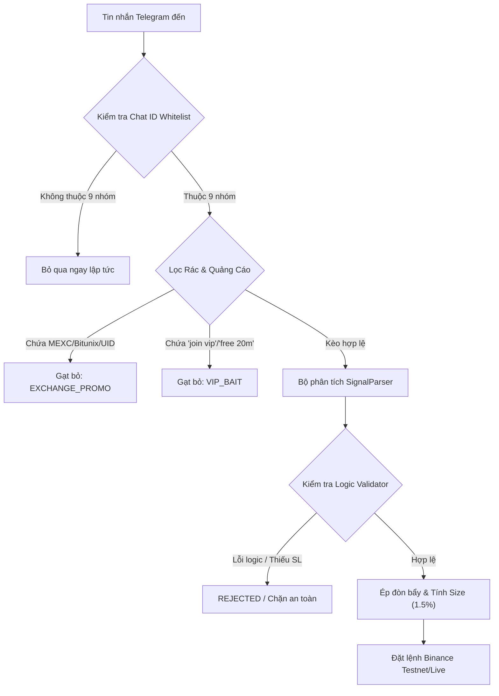

# TÀI LIỆU KẾT XUẤT KIẾN THỨC VÀ HƯỚNG DẪN BẮN KÈO TELEGRAM - BINANCE
**Hệ thống Phân tích & Tự động hóa Giao dịch Telegram Binance Signal Executor**  
*Dữ liệu kiểm chứng: 25.070 tin nhắn trong 6 tháng (20/04/2026 – 17/10/2026)*

---

## 1. TỔNG QUAN & PHẠM VI ÁP DỤNG

Tài liệu này hệ thống hóa toàn bộ kiến thức, quy luật định dạng, đặc trưng hành vi và cơ chế phòng vệ rủi ro sau quá trình quét, phân tích và chuẩn hóa dữ liệu từ các nhóm tín hiệu Telegram hàng đầu.

### 1.1. Danh mục 8 Kênh Ghim Chính thức (Whitelist)
Toàn bộ hệ thống bot chỉ lắng nghe và giao dịch trên 8 nhóm được xác thực sau:

| STT | Tên Kênh Telegram | Chat ID | Tỉ Lệ Thắng Thực Tế | Tỷ lệ Kèo Chuẩn | Đòn bẩy Áp dụng | Mức độ Ưu tiên |
|:---:|:---|:---:|:---:|:---:|:---:|:---:|
| 1 | **CRYPTO LEOPARD'S** | `-1002052872813` | **84.6%** | 98.3% | 20x - 50x | 🥇 **Ưu tiên 1** (Vào vùng giá BELOW cực tốt) |
| 2 | **Crypto Neon** | `-1001370457350` | **80.0%** | 99.4% | **10x cố định** | 🥈 **Ưu tiên 1** (Kỷ luật cao, TP1 +0.7%) |
| 3 | **Crypto spider 🕷️ scalper** | `-1001895315984` | **78.9%** | 98.6% | 20x - 50x | 🥉 **Ưu tiên 1** (Scalp ngắn chuẩn, ít rác) |
| 4 | **THE CRYPTO TRADER** | `-1001590450482` | **63.9%** | 81.4% | 20x | ⭐⭐⭐ **Ăn đậm** (R:R cao 1:2.02, ghép 2 bước) |
| 5 | **THE WOLF (CRYPTO)®** | `-1002007658025` | **56.4%** | 87.4% | 20x - 50x | ⭐⭐⭐ **Khá** (TP dải gạch nối, R:R 1:1.24) |
| 6 | **Global Crypto Research** | `-1001161683441` | **55.0%** | 86.9% | 20x | ⭐⭐⭐ **Khá** (SL chặt 3.36%, TP xa +7.1%) |
| 7 | **THE MASTER (CRYPTO)** | `-1002266035358` | **52.5%** | 96.0% | 25x - 50x | ⭐⭐⭐ **Trung bình** (Kèo nhiều, Entry Zone) |
| 8 | **Crypto World Updates** | `-1001652601224` | **47.5%** | 94.6% | 20x - 50x | ⭐⭐ **Hơi yếu** (Tần suất dày) |

### 1.2. Danh mục 3 Kênh Bị Loại Bỏ (Blacklist)
- **`Crypto Hunters` (`-1002191067035`):** Tỉ lệ quét Stop Loss thực tế trên sàn lên tới **77.5%** (Win rate chỉ 22.5%). Mặc dù trên channel đăng 151 tin chốt lời và 0 tin báo lỗ (giấu lỗ), nhưng thực tế nến sàn Binance cho thấy râu nến quét SL trước khi kịp chạm TP1. Đã tắt hoàn toàn.
- **`CRYPTO MONK` (`-1001552004524`):** Tin quá thưa (64 tin/3 tháng), tỷ lệ rác dụ VIP lên đến 17.2%, thường xuyên gặp lỗi mâu thuẫn tiêu đề ghi `SHORT` nhưng nội dung ghi `BUY`. Đã tắt hoàn toàn.
- **`ESTR - EAT SLEEP TRADE REPEAT` (`-1001656921849`):** Tỷ lệ lỗi logic SL/TP lên tới 72.7% do admin soạn nhầm template (SL cao hơn Entry của lệnh LONG, TP ngược chiều). Đã tắt hoàn toàn.

---

## 2. PHÂN TÍCH ĐẶC TRƯNG TỪNG NHÓM & QUY TẮC PARSER

### 2.1. Nhóm Kỷ Luật Cao Nhất: Crypto Neon (`-1001370457350`)
- **Đặc trưng lệnh:**
  - Form chuẩn mực: `#SYMBOL | DIRECTION SETUP`, ví dụ `#CIEN | SHORT SETUP`, `#BEL | SHORT SETUP`.
  - Có đầy đủ Entry, Target 1, Target 2, Target 3, Stop Loss.
  - **Quy tắc Stop Loss cố định:** 100% các lệnh có mức cắt lỗ chính xác **-5.00%** từ giá Entry.
- **Rủi ro chí mạng nếu không can thiệp:** 
  - Ở đòn bẩy 50x, mức thanh lý (Liquidation) là `-2.0%` (vốn bay trước khi chạm SL 5%).
- **Cơ chế xử lý của Bot:**
  - Kích hoạt chính sách override riêng cho kênh: `default_leverage_override: 10`, `max_leverage_override: 10`.
  - Với đòn bẩy 10x, mức thanh lý là `-10.0%`, tạo vùng đệm an toàn gấp đôi biên độ Stop Loss 5.0%.
  - Tỷ lệ khớp TP1 (+0.70%) đạt **81.1%**, ngay lập tức kích hoạt kéo SL về Breakeven (Hòa vốn).

### 2.2. Nhóm Tần Suất Scalp Cao: Crypto spider 🕷️ scalper (`-1001895315984`)
- **Đặc trưng lệnh:**
  - Sử dụng ký tự mũi tên unicode đặc thù: `ENTRY ➔ 0.04955`, `TP1 ➔ 0.05060`.
  - Có tới 408 kèo hợp lệ trong 6 tháng, tỷ lệ rác cực thấp (0.4%).
- **Cơ chế xử lý của Bot:**
  - Bộ chuẩn hóa `normalizer.py` quy đổi toàn bộ các biến thể mũi tên `➔`, `➜`, `→`, `▶` về định dạng tiêu chuẩn `->`.
  - Bắt gọn các mức chốt lời đa tầng mà không bỏ sót giá.

### 2.3. Nhóm Định Dạng Dải Gạch Nối: THE WOLF (CRYPTO)® (`-1002007658025`)
- **Đặc trưng lệnh:**
  - Ký hiệu: `👍THE WOLF SCALPER👍`, `🚀 SHORT: $RSR/USDT`.
  - Đích Take Profit viết liền dạng chuỗi gạch nối: `TAKE- PROFIT \n\n 0.002350-0.002250-0.002050`.
  - Kèm theo 1.154 tin quảng cáo sàn Bitunix trong 6 tháng.
- **Cơ chế xử lý của Bot:**
  - Regex bóc tách chuỗi gạch nối: `re.split(r'\s*-\s*', ...)` để trích xuất đầy đủ mảng TP1, TP2, TP3.
  - Bộ lọc `is_exchange_promo` loại bỏ 100% các tin "Click to join Bitunix" và kết quả khoe lãi rác.

### 2.4. Nhóm Bắn Kèo 2 Bước: THE CRYPTO TRADER (`-1001590450482`)
- **Đặc trưng lệnh:**
  - **Bước 1:** Bắn tin cảnh báo nhanh không có Stop Loss: `LONG BAT 0.207055`.
  - **Bước 2 (sau 1-3 phút):** Bắn bảng tin chi tiết với markdown đậm: `__****__`, đầy đủ 6 mức TP và Stop Loss.
- **Cơ chế xử lý của Bot:**
  - Bước 1 bị giữ ở trạng thái chờ (Pending Review do thiếu SL bắt buộc).
  - Khi Bước 2 tới, cơ chế Re-linking tự động ghép dữ liệu Stop Loss và kích hoạt lệnh đầy đủ.

### 2.5. Nhóm Cấu Trúc Entry Zone & BELOW: THE MASTER & LEOPARD
- **THE MASTER (`-1002266035358`):** Sử dụng `Entry Zone: 0.1988`. Bot hỗ trợ nhận diện từ khóa `Entry Zone` vào chế độ Single Entry hoặc Range Entry.
- **CRYPTO LEOPARD'S (`-1002052872813`):** Sử dụng cú pháp `Short BELOW (82.3k)(82.5k)`. Bot hỗ trợ nhận diện hậu tố `k` (`*1000`) và chia 2 mức Entry có trọng số.

---

## 3. MA TRẬN PHÂN LOẠI & NHẬN DIỆN TIN RÁC (SPAM TAXONOMY)

| Loại Tin Nhắn | Dấu Hiệu Từ Khóa / Regex | Hành Vi Xử Lý Của Bot |
|:---|:---|:---|
| **Tin Bắn Kèo (SIGNAL)** | Chứa cặp coin `/USDT`, từ khóa `LONG`/`SHORT`, `Entry`, `Stop Loss`, `Targets` | Phân tích giá, tính toán rủi ro 1.5%, kiểm tra đòn bẩy, đặt lệnh |
| **Báo Chốt Lời / Dời SL (TRADE_UPDATE)** | `Target 1 Done`, `TP1 Hit`, `SL moved to entry`, `Breakeven` | Cập nhật vị thế, dời Stop Loss lên hòa vốn, đóng lệnh trailing |
| **Quảng Cáo Sàn (EXCHANGE_PROMO)** | `MEXC exchange`, `send me your UID`, `bitunix.com`, `bonus`, `register?inviteCode` | Cô lập và bỏ qua hoàn toàn, không đưa vào pipeline phân tích lệnh |
| **Dụ Đăng Ký VIP (VIP_BAIT)** | `join vip`, `only 20 minutes left`, `she accept 10 people`, `t.me/+...` | Chặn đứng 100%, ghi log bảo vệ |
| **Tin Tức Thị Trường (COMMENTARY_NEWS)** | Phân tích nến BTC, tin tức kinh tế vĩ mô, chào buổi sáng | Ghi nhận làm thông tin tham khảo, không sinh lệnh giao dịch |

---

## 4. QUY TẮC QUẢN LÝ VỐN & THIẾT LẬP AN TOÀN

1. **Chế độ Ký quỹ (Margin Mode):** Bắt buộc **ISOLATED** (Cô lập ký quỹ cho từng lệnh). Nghiêm cấm dùng Cross Margin để tránh rủi ro quét sạch tài khoản khi có biến động bất ngờ.
2. **Tỷ lệ Rủi ro mỗi Lệnh (Risk Per Signal):** **1.5% tổng số dư tài khoản**.
   $$\text{Kích thước Lệnh (Notional)} = \frac{\text{Số dư} \times 1.5\%}{\text{Khoảng cách SL (\%)}}$$
3. **Đòn bẩy (Leverage):**
   - **Mặc định toàn hệ thống:** 20x (Tối đa 50x cho các lệnh có SL chặt < 1%).
   - **Riêng Crypto Neon:** Cố định **10x** để phù hợp biên độ SL 5%.
4. **Chiến lược Chốt Lời (Take Profit):**
   - **TP1 (Chốt 60% vị thế):** Đạt lợi nhuận ban đầu.
   - **TP2 (Chốt 25% vị thế):** Mở rộng lợi nhuận.
   - **TP3 (Chốt 15% vị thế):** Giữ vị thế theo xu hướng dài (Runner).
5. **Cơ chế Dời Lỗ Hòa Vốn (Breakeven Trailing):** Ngay khi **TP1 khớp**, bot tự động gửi lệnh Algo Stop Market dời mức cắt lỗ của toàn bộ phần vị thế còn lại về đúng điểm giá Entry (cộng thêm 0.05% phí sàn). Sau thời điểm này, vị thế nắm chắc 100% không thể lỗ.

---

## 5. HƯỚNG DẪN VẬN HÀNH & GIÁM SÁT

- **Khởi động Giao diện:** Chạy file `launch_app.bat` hoặc mở `desktop/src-tauri/target/release/app.exe`.
- **Chế độ Testnet:** Mặc định `mode: TESTNET` với API key sàn cấp để theo dõi và tích lũy dữ liệu thực tế.
- **Xem Dữ liệu Phân loại Chi tiết:** File JSON lưu trữ kết quả phân loại 6 tháng tại `data/all_9_channels_6_months_classified.json`.
- **Kiểm thử Hệ thống:** Chạy `pytest tests/ -v` (76/76 bài test tự động bảo đảm chuẩn mực mã nguồn).

